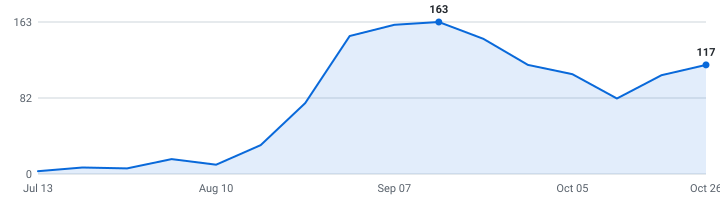

# 🎓 Summer 2027 Tech Internships

**A self-updating engine that tracks tech internships so you don't have to.**

&nbsp;&nbsp;&nbsp;

### 501 open roles (398 listed below) · 68 new this week

4,795 employers tracked · data as of Oct 20, 2026 at 23:35 UTC

_175 have a cycle the employer stated · 326 are recent postings whose cycle isn't stated (listed separately, never mixed in)._

**[🖥️ Live dashboard](https://harshaprakash1.github.io/Automated-List-Of-Spring-2027-Tech-Internships/)** · **[📡 RSS](https://harshaprakash1.github.io/Automated-List-Of-Spring-2027-Tech-Internships/feed.xml)** · **[⚙️ JSON API](https://harshaprakash1.github.io/Automated-List-Of-Spring-2027-Tech-Internships/api/jobs.json)** · **[✉️ Email alerts](https://harshaprakash1.github.io/Automated-List-Of-Spring-2027-Tech-Internships/#subscribe)**

> [!TIP]
> **⭐ Star this repo** to save it and get updates when new roles are added.

Instead of refreshing a dozen career pages by hand, it reads company hiring feeds directly and keeps one live list — newest roles on top, refreshed automatically throughout the day.

**🔔 New roles in your inbox:** [subscribe by email](https://harshaprakash1.github.io/Automated-List-Of-Spring-2027-Tech-Internships/#subscribe) - one email a day, only when new internships actually appeared, unsubscribe from any email in two clicks. (Prefer RSS-to-email? [Feedrabbit works too](https://feedrabbit.com/subscriptions/new?url=https%3A%2F%2Fraw.githubusercontent.com%2FHarshaPrakash1%2FAutomated-List-Of-Spring-2027-Tech-Internships%2Fmain%2Fdocs%2Ffeed.xml).)

---

## What this is

This is an engine, not a hand-kept list. It polls company career feeds every 30 minutes, finds the internships, removes duplicates, and rebuilds this page on its own.

Every link comes straight from the source — so it's real and current, not a stale list someone forgot to update. Speed matters.

## What makes this different

| | |
|---|---|
| 📅 **[Drop Radar](#drop-radar)** | A forecast of **what's coming**. Each marquee company's typical opening window, replaced by the real drop date the moment the engine catches it live. Windows are estimates and labelled as such; only dates the engine saw itself are marked verified. |
| 🛂 **Visa intel, computed** | 🇺🇸 / 🛂 flags detected automatically from every job description, plus ✓ for employers with a real H-1B track record (USCIS data, FY2022-23 — a history, not a promise). The big lists crowdsource this by hand; here it's code. Most postings say nothing either way, and those show as unknown rather than guessed. |
| 📆 **A real date on nearly every role** | Taken from the job portal itself wherever the portal states one, so newest-first actually means newest. The exact coverage figure is printed at the bottom of this page every run. |
| 🧰 **Skill tags + pay, extracted** | Every posting's text is scanned for the stack it wants (Python, C++, PyTorch, …) and the pay it states — searchable on the [dashboard](https://harshaprakash1.github.io/Automated-List-Of-Spring-2027-Tech-Internships/), and included in the CSV and API. |
| 🔔 **Alerts your way** | [Email digests](https://harshaprakash1.github.io/Automated-List-Of-Spring-2027-Tech-Internships/#subscribe) or [RSS](https://harshaprakash1.github.io/Automated-List-Of-Spring-2027-Tech-Internships/feed.xml) — point any reader, or a Slack/Discord RSS integration, at it. Plus a [live dashboard](https://harshaprakash1.github.io/Automated-List-Of-Spring-2027-Tech-Internships/) with search, filters, and a saved-roles list that never leaves your browser. |
| ⚙️ **An engine, not a spreadsheet** | 5,084 job-board endpoints (4,795 distinct employers; some run more than one board) polled every 30 minutes across 12 ATS platforms. Full source and tests in this repo. |

## Scope

| | |
|---|---|
| **Roles** | Software Engineering, Data Science & Machine Learning (and closely related technical internships) |
| **Region** | United States |
| **Cycles** | Spring 2027 |

## About

I'm an international student studying in the United States, so I built this for the search I'm doing myself. The list is US roles only for now — that's where I'm searching.

Use it to spot roles early and apply before they fill up. Being first genuinely helps.

## Where this is going

I'm building this in the open and adding to it as it grows.

**Recently shipped:** email alerts · the Drop Radar · auto-detected sponsorship flags · the live dashboard

**Next up:** personalized alerts (pick your categories) · per-company hiring pages · a ghost-posting detector

If it helps you, a star means a lot and tells me to keep going.

## How to use

<b>Reading the table — flags, dates, and the cycle split</b> (click to expand)

- Roles are grouped by cycle below - **newest posting on top, oldest at the bottom.**
- A cycle section holds only roles whose **employer stated that cycle** - in the title, or in the posting's own text. Postings that name no cycle anywhere are in *Recently posted — cycle not stated* further down, with **no cycle guessed for them**. Same quality bar, different amount of evidence.
- The **Posted** column is the date the company published the role.
- **_(3 openings)_ after a role title** = the employer has that many separate live requisitions for the same job, in the same place, for the same cycle. They're all real and each takes its own application, so they're linked individually (**Apply**, then **#2**, **#3**) instead of repeating the row. Counts still count requisitions, and the CSV export is never grouped.
- **🆁 after a company name** = **this role is remote** — the posting's own location or title says so. It marks the role on that row, not the whole company.
- **Flags after a role title:** 🇺🇸 = requires U.S. citizenship or a security clearance · 🛂 = the posting says it won't sponsor a work visa · 🆕 = spotted in the last 48 hours. Sponsorship flags are detected automatically from each job description - treat them as a strong hint and confirm on the posting.
- **✓ after a company name** = a real H-1B track record: USCIS approved 10+ petitions for that employer in FY2022–2023 (matched automatically against the official [H-1B Employer Data Hub](https://www.uscis.gov/tools/reports-and-studies/h-1b-employer-data-hub)). No ✓ doesn't mean they won't sponsor - it means we can't prove they have.
- Track your applications with [`data/internships.csv`](data/internships.csv) (opens in Excel / Google Sheets).
- Missing a company? Adding one takes a single line, see [CONTRIBUTING.md](CONTRIBUTING.md).

---

## Spring 2027  (131 employer-stated)

| Company | Role | Category | Location | Skills | Posted | Apply |
|---|---|---|---|---|---|---|
| Uber | 2027 Software Engineering Intern, US 🆕 | Software | San Francisco +8 more | Python, Java, C++, Ruby | Oct 20, 2026 | [Apply](https://iaziqy.fa.ocs.oraclecloud.com/hcmUI/CandidateExperience/en/sites/CX_1/job/303922) |
| Anduril | 2027 Finance Data Analyst Intern 🆕 | Data & ML/AI | Costa Mesa, California, United States | Python, SQL, LLMs, Computer Vision | Oct 20, 2026 | [Apply](https://boards.greenhouse.io/andurilindustries/jobs/5269977007?gh_jid=5269977007) |
| Toyota | 2027 TFS Data Science Internship 🆕 | Data & ML/AI | Plano, Texas | Python, SQL, scikit-learn, Pandas | Oct 20, 2026 | [Apply](https://toyota.wd503.myworkdayjobs.com/tmna/job/Plano-Texas/XMLNAME-2027-TFS-Data-Science-Internship_10338545-1) |
| Skydio ✓ | Embedded Software Engineer Intern - Winer 2027 🆕 | Software | San Mateo, California, United States | Python, C++, Linux | Oct 20, 2026 | [Apply](https://jobs.ashbyhq.com/skydio/370da6a5-5ae6-48fe-8e08-9b1dcc63bf34) |
| Stand Together | KIP Spring 2027 - Policy Data Analyst Intern - Empire Center for Public Policy 🆕 | Data & ML/AI | New York | Tableau | Oct 20, 2026 | [Apply](https://jobs.lever.co/standtogether/35deb481-fc0b-4513-abf5-68880006189b) |
| Bosch ✓ | Software Engineering Co-Op - Spring 2027 🆕 | Software | Fountain Inn, SC, United States | C++, PyTorch, TensorFlow, Computer Vision | Oct 19, 2026 | [Apply](https://jobs.smartrecruiters.com/BoschGroup/744000156311682) |
| Northrop Grumman | 2027 Software Engineering Intern - Aurora CO 🇺🇸 _(2 openings)_ | Software | United States-Colorado-Aurora | No skills listed | Oct 16, 2026 | [Apply](https://ngc.wd1.myworkdayjobs.com/Northrop_Grumman_External_Site/job/United-States-Colorado-Aurora/XMLNAME-2027-Software-Engineering-Intern---Aurora-CO_R10256243) [#2](https://ngc.wd1.myworkdayjobs.com/Northrop_Grumman_External_Site/job/United-States-Colorado-Aurora/XMLNAME-2027-Software-Engineering-Intern---Aurora-CO_R10256393) |
| Northrop Grumman | 2027 Software Engineering Intern - Boulder CO 🇺🇸 | Software | United States-Colorado-Boulder | No skills listed | Oct 16, 2026 | [Apply](https://ngc.wd1.myworkdayjobs.com/Northrop_Grumman_External_Site/job/United-States-Colorado-Boulder/XMLNAME-2027-Software-Engineering-Intern---Boulder-CO_R10256077) |
| Northrop Grumman | 2027 Software Engineering Intern - Colorado Springs 🇺🇸 _(2 openings)_ | Software | United States-Colorado-Colorado Springs | No skills listed | Oct 16, 2026 | [Apply](https://ngc.wd1.myworkdayjobs.com/Northrop_Grumman_External_Site/job/United-States-Colorado-Colorado-Springs/XMLNAME-2027-Software-Engineering-Intern---Colorado-Springs_R10256080) [#2](https://ngc.wd1.myworkdayjobs.com/Northrop_Grumman_External_Site/job/United-States-Colorado-Colorado-Springs/XMLNAME-2027-Software-Engineering-Intern---Colorado-Springs_R10256259) |
| Sanofi | 2027 Spring Co op Biologics Design and AI Cambridge MA | Data & ML/AI | Cambridge, MA | Python, PyTorch, TensorFlow, LLMs | Oct 16, 2026 | [Apply](https://sanofi.wd3.myworkdayjobs.com/SanofiCareers/job/Cambridge-MA/XMLNAME-2027-Spring-Co-op-Biologics-Design-and-AI-Cambridge-MA_R2854337) |
| Commonwealth Fusion Systems | Intern - AI & Infrastructure Engineer - Spring 2027 | Data & ML/AI | Devens, MA | Python, LLMs, Docker, Linux | Oct 15, 2026 | [Apply](https://jobs.lever.co/cfsenergy/fa87d365-ac8a-44c3-8fda-c9dec3ea8878) |
| Nissan | Machine Learning Research Intern - Spring 2027 - Santa Clara, CA | Data & ML/AI | Santa Clara +1 more | Python, PyTorch, TensorFlow, scikit-learn | Oct 14, 2026 | [Apply](https://alliance.wd3.myworkdayjobs.com/nissanjobs/job/Santa-Clara-California---United-States-of-America/Machine-Learning-Research-Intern---Spring-2027---Santa-Clara--CA_R00214268) |
| Nissan | Machine Learning Research Perception Intern - Spring 2027 - Santa Clara, CA _(2 openings)_ | Data & ML/AI | Santa Clara +1 more | Python, C++, Linux, ROS | Oct 14, 2026 | [Apply](https://alliance.wd3.myworkdayjobs.com/nissanjobs/job/Santa-Clara-California---United-States-of-America/Machine-Learning-Research-Perception-Intern---Spring-2027---Santa-Clara--CA_R00214260) [#2](https://alliance.wd3.myworkdayjobs.com/nissanjobs/job/Santa-Clara-California---United-States-of-America/Machine-Learning-Research-Perception-Intern---Spring-2027---Santa-Clara--CA_R00215332) |
| Nissan | Machine Learning Research Prediction and Planning Intern - Spring 2027 - Santa Clara, CA | Data & ML/AI | Santa Clara +1 more | Python, C++, Computer Vision | Oct 14, 2026 | [Apply](https://alliance.wd3.myworkdayjobs.com/nissanjobs/job/Santa-Clara-California---United-States-of-America/Machine-Learning-Research-Prediction-and-Planning-Intern---Spring-2027---Santa-Clara--CA_R00214262) |
| JPMorganChase ✓ | 2027 AI Research Associate Program - Internship | Data & ML/AI | New York, NY, United States | Python, PyTorch, TensorFlow, LLMs | Oct 14, 2026 | [Apply](https://jpmc.fa.oraclecloud.com/hcmUI/CandidateExperience/en/sites/CX_1/job/210800354) |
| The Walt Disney Company | Cybersecurity Intern, Spring 2027 | Security | Lake Buena Vista, FL, USA | Git | Oct 14, 2026 | [Apply](https://disney.wd5.myworkdayjobs.com/disneycareerdc/job/Lake-Buena-Vista-FL-USA/Cybersecurity-Intern--Spring-2027_FOS-0000451290) |
| General Motors ✓ | 2027 Intern - AI/ML Engineer - Capacity & Performance Engineering, Autonomous Vehicles | Data & ML/AI | Sunnyvale +2 more | Python, Java, C++, SQL | Oct 14, 2026 | [Apply](https://generalmotors.wd5.myworkdayjobs.com/Careers_GM/job/Sunnyvale-California-United-States-of-America/XMLNAME-2027-Intern---AI-ML-Engineer---Capacity---Performance-Engineering--Autonomous-Vehicles_JR-202622406) |
| General Motors ✓ | 2027 Intern - AI/ML Engineer, Autonomous Vehicle ML Infrastructure | Data & ML/AI | Sunnyvale +2 more | Python, Java, C++, Kubernetes | Oct 14, 2026 | [Apply](https://generalmotors.wd5.myworkdayjobs.com/Careers_GM/job/Sunnyvale-California-United-States-of-America/XMLNAME-2027-Intern---AI-ML-Engineer--Autonomous-Vehicle-ML-Infrastructure_JR-202622410) |
| Anduril | 2027 Firmware Engineer Intern | Hardware | Costa Mesa, California, United States | Computer Vision | Oct 13, 2026 | [Apply](https://boards.greenhouse.io/andurilindustries/jobs/5265158007?gh_jid=5265158007) |
| Field AI | Robotics Research, Embodied AI Intern (Spring & Summer 2027) | Data & ML/AI | Irvine, CA | Python, C++, ROS | Oct 13, 2026 | [Apply](https://jobs.lever.co/field-ai/ef35c537-b864-479f-9dbe-b30429ac7704) |
| Tenet3 | Software Developer (Full Stack) Intern (Spring 2027) | Software | Dayton, Ohio | Django, AWS, Docker, Git | Oct 09, 2026 | [Apply](https://job-boards.greenhouse.io/tenet3/jobs/8878874002) |
| Sanofi | 2027 Spring Co-op Data Science & Digital Transformation, Framingham, MA | Data & ML/AI | Framingham, MA | Python | Oct 09, 2026 | [Apply](https://sanofi.wd3.myworkdayjobs.com/SanofiCareers/job/Framingham-MA/XMLNAME-2027-Spring-Co-op-Data-Science---Digital-Transformation--Framingham--MA_R2854091) |
| Viget | Software Developer Intern (2027) 🛂 | Software | Boulder, CO | Python, JavaScript, Ruby, React | Oct 08, 2026 | [Apply](https://jobs.lever.co/viget/b18cc87d-fca2-485a-a0f2-ad6197db63f2) |
| Amazon ✓ | Embedded Firmware Co-op, Amazon Robotics - Spring 2027 | Hardware | North Reading, Massachusetts, USA | C++, Rust, LLMs, Computer Vision | Oct 08, 2026 | [Apply](https://www.amazon.jobs/en/jobs/10573570/embedded-firmware-co-op-amazon-robotics-spring-2027) |
| SoloPulse | Software Engineer Intern/Co-op - Spring 2027 | Software | Peachtree Corners, GA | Python, C++, PyTorch, CUDA | Oct 08, 2026 | [Apply](https://jobs.lever.co/solopulseco/1b36afea-e8eb-4cea-a6e9-0afc384d06ef) |
| Rugged Robotics | Robotic Software Intern/Co-op (Spring or Summer 2027) | Software | Houston, TX | Python, C++ | Oct 08, 2026 | [Apply](https://job-boards.greenhouse.io/ruggedrobotics/jobs/4730908005) |
| RTX | Software Engineering Co-op (Spring/Summer 2027) _(2 openings)_ | Software | US-IA-CEDAR RAPIDS-130 ~ 5350 C Ave NE… | C++, Linux | Oct 07, 2026 | [Apply](https://globalhr.wd5.myworkdayjobs.com/rec_rtx_ext_gateway/job/US-IA-CEDAR-RAPIDS-130--5350-C-Ave-NE--BLDG-130/Software-Engineering-Co-op--Spring-Summer-2027-_01879726) [#2](https://globalhr.wd5.myworkdayjobs.com/rec_rtx_ext_gateway/job/US-IA-CEDAR-RAPIDS-130--5350-C-Ave-NE--BLDG-130/Software-Engineering-Co-op--Spring-Summer-2027-_01881996) |
| Hudson River Trading ✓ | Data Scientist Intern - 2027 | Data & ML/AI | London +4 more | Python, Pandas | Oct 05, 2026 | [Apply](https://www.hudsonrivertrading.com/careers/job/?gh_jid=8257369) |
| The Walt Disney Company | ESPN Programming Intern, Bristol, Spring 2027 | Software | Bristol, CT, USA | No skills listed | Oct 05, 2026 | [Apply](https://disney.wd5.myworkdayjobs.com/disneycareerdc/job/Bristol-CT-USA/ESPN-Intern--Bristol--Spring-2027_10160482) |
| Manulife Financial | Spring Co-op 2027 - Software Engineering, Security & Operations | Security | Boston, Massachusetts | HTML/CSS, Azure, Git | Oct 05, 2026 | [Apply](https://manulife.wd3.myworkdayjobs.com/MFCJH_Jobs/job/Boston-Massachusetts/Spring-Co-op-2027---Software-Engineering--Security---Operations_JR26091121) |
| State of North Carolina | Data Science Intern | Data & ML/AI | Wake County, NC | Python, SQL, Pandas, LLMs | Oct 05, 2026 | [Apply](https://nc.wd108.myworkdayjobs.com/NC_Careers/job/Wake-County-NC/Data-Science-Intern_JR-125225) |
| xAI | Spring 2027 Software Engineering Internship/Co-op | Software | Palo Alto, CA | Python, Java, C++, C# | Oct 02, 2026 | [Apply](https://job-boards.greenhouse.io/xai/jobs/5252108007) |
| Bedrock Robotics | 2027 Internship Behavior ML Engineer, Learned Manipulation Policies | Data & ML/AI | San Francisco, CA | Python, PyTorch | Oct 02, 2026 | [Apply](https://jobs.ashbyhq.com/bedrock-robotics/96a6423e-7439-4cb4-9109-117b14e47f7c) |
| The Walt Disney Company | WABC - TV (ABC7) Programming Intern, Spring 2027 | Software | New York, NY, USA | No skills listed | Oct 01, 2026 | [Apply](https://disney.wd5.myworkdayjobs.com/disneycareerdc/job/New-York-NY-USA/WABC---TV--ABC7--Programming-Intern--Spring-2027_10158770-1) |
| Pinterest ✓ 🆁 | Software Engineer Intern 2027 (USA) | Software | San Francisco, CA, US; Remote, US | Python, Java, C++, TypeScript | Oct 01, 2026 | [Apply](https://www.pinterestcareers.com/jobs/?gh_jid=7838577) |
| Pinterest ✓ | Master's Machine Learning Internship 2027 (USA) | Data & ML/AI | San Francisco +11 more | Python, Java, C++, PyTorch | Oct 01, 2026 | [Apply](https://www.pinterestcareers.com/jobs/?gh_jid=8138090) |
| Pinterest ✓ | Master's Data Science Internship 2027 (USA) | Data & ML/AI | San Francisco +11 more | Python, SQL | Oct 01, 2026 | [Apply](https://www.pinterestcareers.com/jobs/?gh_jid=8138097) |
| The Federal Reserve System | TS - Application Security Intern - 2027 🇺🇸 | Security | Cleveland, OH | No skills listed | Oct 01, 2026 | [Apply](https://rb.wd5.myworkdayjobs.com/FRS/job/Cleveland-OH/TS---Application-Security-Intern---2027_R-0000033625) |
| Allen Control Systems | Android Developer Intern, 2027 | Software | Austin, TX | Kotlin, Computer Vision | Sep 30, 2026 | [Apply](https://jobs.ashbyhq.com/allen-control-systems/1cd2b432-9a01-4ae0-8eb2-6ebd9c278b94) |
| Amazon ✓ | Software Development Engineer Intern, AWS Database - 2027 (US) | Software | Seattle, Washington, USA | AWS, Python, Java, C++ | Sep 30, 2026 | [Apply](https://www.amazon.jobs/en/jobs/10565667/software-development-engineer-intern-aws-database-2027-us) |
| Dow Chemical Company ✓ | Data Engineer / Data Platform Engineer Internship Spring 2027 Semester at the Dow Delivery Center at UIUC (Champaign, IL) 🛂 | Data & ML/AI | Kankakee (IL, USA) | Python, SQL, Scala, AWS | Sep 30, 2026 | [Apply](https://dow.wd1.myworkdayjobs.com/ExternalCareers/job/Kankakee-IL-USA/Data-Engineer---Data-Platform-Engineer-Internship-Spring-2027-Semester-at-the-Dow-Delivery-Center-at-UIUC--Champaign--IL-_R2068792) |
| RTX | Software Engineering Co-op  (Spring/Summer 2027) 🇺🇸 | Software | US-IA-CEDAR RAPIDS-166 ~ 855 35Th St NE… | Python, C++, Bash, Linux | Sep 29, 2026 | [Apply](https://globalhr.wd5.myworkdayjobs.com/rec_rtx_ext_gateway/job/US-IA-CEDAR-RAPIDS-166--855-35Th-St-NE--BLDG-166/Software-Engineering-Co-op---Embedded-Linux--Spring-Summer-2027-_01876384) |
| Honeywell | Spring 2027 Software Engineering Co-op | Software | United States | No skills listed | Sep 29, 2026 | [Apply](https://ibqbjb.fa.ocs.oraclecloud.com/hcmUI/CandidateExperience/en/sites/CX_1/job/158957) |
| Honeywell | Spring 2027 Artificial Intelligence/Machine Learning Co-Op | Data & ML/AI | United States | Python, C++, JavaScript | Sep 29, 2026 | [Apply](https://ibqbjb.fa.ocs.oraclecloud.com/hcmUI/CandidateExperience/en/sites/CX_1/job/158958) |
| Hermeus | Flight Software Engineering Intern (Simulation/Hardware-In-The-Loop) - Spring & Summer 2027 🇺🇸 | Hardware | Los Angeles, CA | Python, C++, MATLAB, Linux | Sep 29, 2026 | [Apply](https://jobs.lever.co/hermeus/78008094-ca81-4a0c-9a18-93b30f932acd) |
| GITAI | Field-Deployed Software Engineering Intern – Fall 2026 / Spring 2027 🇺🇸 | Software | Los Angeles, California, United States | Python, C++, PyTorch, Computer Vision | Sep 28, 2026 | [Apply](https://job-boards.greenhouse.io/gitai/jobs/5437128008) |
| RTX | Software Engineering Co-op (Spring/Summer 2027) 🇺🇸 _(3 openings)_ | Software | US-IA-CEDAR RAPIDS-131 ~ 5450 C Ave NE… | Python, C++ | Sep 28, 2026 | [Apply](https://globalhr.wd5.myworkdayjobs.com/rec_rtx_ext_gateway/job/US-IA-CEDAR-RAPIDS-131--5450-C-Ave-NE--BLDG-131/Software-Engineering-Co-op--Spring-Summer-2027-_01871645) [#2](https://globalhr.wd5.myworkdayjobs.com/rec_rtx_ext_gateway/job/US-IA-CEDAR-RAPIDS-131--5450-C-Ave-NE--BLDG-131/Software-Engineering-Co-op--Spring-Summer-2027-_01879727) [#3](https://globalhr.wd5.myworkdayjobs.com/rec_rtx_ext_gateway/job/US-IA-CEDAR-RAPIDS-131--5450-C-Ave-NE--BLDG-131/Software-Engineering-Co-op--Spring-Summer-2027-_01878369) |
| The Aerospace Corporation | 2027 Software Tools and Assurance Engineering Grad Intern 🇺🇸 | Software | El Segundo, CA | Python, Java, C++ | Sep 28, 2026 | [Apply](https://aero.wd5.myworkdayjobs.com/external/job/El-Segundo-CA/XMLNAME-2027-Software-Tools-and-Assurance-Engineering-Grad-Intern_R016753) |
| onsemi | Spring 2027 - Data Analyst Intern | Data & ML/AI | Scottsdale, AZ, United States | Python, JavaScript, SQL, Azure | Sep 28, 2026 | [Apply](https://hctz.fa.us2.oraclecloud.com/hcmUI/CandidateExperience/en/sites/CX_1001/job/2506290) |
| onsemi | Spring 2027 - Corporate Strategy AI/ML Intern | Data & ML/AI | San Jose, CA, United States | Python, LLMs | Sep 28, 2026 | [Apply](https://hctz.fa.us2.oraclecloud.com/hcmUI/CandidateExperience/en/sites/CX_1001/job/2506526) |
| AbbVie ✓ | 2027 Business Technology Solutions Intern - Cybersecurity (Undergraduate) | Security | North Chicago +2 more | Python, Java, C#, JavaScript | Sep 25, 2026 | [Apply](https://jobs.smartrecruiters.com/AbbVie/3743990015679246) |
| AbbVie ✓ | 2027 Business Technology Solutions Intern - Cloud Engineering (Undergraduate) | Software | North Chicago +2 more | HTML/CSS, AWS, GCP, Azure | Sep 25, 2026 | [Apply](https://jobs.smartrecruiters.com/AbbVie/3743990015679346) |
| AbbVie ✓ | 2027 Business Technology Solutions Intern - Data & Software Engineering (Undergraduate) | Data & ML/AI | North Chicago +2 more | Python, Java, TypeScript, JavaScript | Sep 25, 2026 | [Apply](https://jobs.smartrecruiters.com/AbbVie/3743990015679386) |
| Voloridge | Quantitative Trading Intern 2027 | Quant | Jupiter, FL | Python, SQL | Sep 24, 2026 | [Apply](https://job-boards.greenhouse.io/voloridgeinvestmentmanagement/jobs/4405530009) |
| Figma ✓ | Data Engineer Intern (2027) | Data & ML/AI | San Francisco, CA • New York, NY | Python, SQL | Sep 23, 2026 | [Apply](https://boards.greenhouse.io/figma/jobs/6178851004?gh_jid=6178851004) |
| Johnson & Johnson | Heart Recovery Software R&D Co-Op 🛂 | Software | Halethorpe +2 more | Python, C++, Git | Sep 23, 2026 | [Apply](https://jj.wd5.myworkdayjobs.com/JJ/job/Halethorpe-Maryland-United-States-of-America/Heart-Recovery-Software-R-D-Co-Op_R-101393) |
| Formlabsinternships | Desktop Software Intern (Winter/Spring 2027) | Software | Somerville, MA | C++ | Sep 22, 2026 | [Apply](https://job-boards.greenhouse.io/formlabsinternships/jobs/8188725) |
| The Aerospace Corporation | 2027 Software Tools and Assurance Intern 🇺🇸 | Software | El Segundo, CA | Python, Java, C++ | Sep 22, 2026 | [Apply](https://aero.wd5.myworkdayjobs.com/external/job/El-Segundo-CA/XMLNAME-2027-Software-Tools-and-Assurance-Intern_R016429) |
| Sanofi | 2027 Spring Co-op Machine Learning AI, Cambridge, MA | Data & ML/AI | Cambridge, MA | Python, LLMs | Sep 22, 2026 | [Apply](https://sanofi.wd3.myworkdayjobs.com/SanofiCareers/job/Cambridge-MA/XMLNAME-2027-Spring-Co-op-Machine-Learning-AI--Cambridge--MA_R2864862) |
| Cowboy Space | Intern, Software Engineering, 2027 🇺🇸 | Software | San Carlos, California | Python, C++, Verilog | Sep 21, 2026 | [Apply](https://jobs.ashbyhq.com/cowboyspace/56d1d7e4-fa7e-4c25-aa8b-6828447fc64a) |
| ONE Finance 🆁 | AI Research Intern 🛂 | Data & ML/AI | United States (Remote) | PyTorch, LLMs | Sep 21, 2026 | [Apply](https://jobs.ashbyhq.com/oneapp/84beb108-c04b-42d3-a9ae-9a91210201b7) |
| Mastercard | AI & Data Co-Op (Northeastern University), Spring 2027 – Purchase, NY, US | Data & ML/AI | Purchase, New York | Python, SQL, scikit-learn, Pandas | Sep 21, 2026 | [Apply](https://mastercard.wd1.myworkdayjobs.com/Campus/job/Purchase-New-York/AI---Data-Co-Op--Northeastern-University---Spring-2027---Purchase--NY--US_R-291653) |
| Amazon ✓ | Data Engineer Internship - 2027 (US) | Data & ML/AI | Seattle, Washington, USA | Python, SQL, Scala, AWS | Sep 18, 2026 | [Apply](https://www.amazon.jobs/en/jobs/10553907/data-engineer-internship-2027-us) |
| Stantec | Transportation Engineering Co-op - Infrastructure (Fall 2026/Spring 2027) | Software | Louisville, KY, United States | No skills listed | Sep 18, 2026 | [Apply](https://hdhl.fa.us6.oraclecloud.com/hcmUI/CandidateExperience/en/sites/CX_1/job/1007850) |
| Honeywell | Data Science Co-Op - Spring/Summer 2027 🇺🇸 | Data & ML/AI | Pittsford, NY, United States | Python, LLMs, AWS, Azure | Sep 17, 2026 | [Apply](https://ibqbjb.fa.ocs.oraclecloud.com/hcmUI/CandidateExperience/en/sites/CX_1/job/157903) |
| Nanopath | Software Development Co-op (Jan '27 Start) | Software | Cambridge, MA | No skills listed | Sep 16, 2026 | [Apply](https://job-boards.greenhouse.io/nanopathinc/jobs/4732881005) |
| Louisiana Blue | CW Healthcare Data Science Intern (Spring 2027) | Data & ML/AI | Corporate - Baton Rouge, LA | Python, SQL, PyTorch, TensorFlow | Sep 16, 2026 | [Apply](https://bcbsla.wd1.myworkdayjobs.com/Generation_Blue/job/Corporate---Baton-Rouge-LA/CW-Healthcare-Data-Science-Intern--Spring-2027-_R12151) |
| Cartesian | IAP Software Engineering Intern 2027 | Software | Cambridge, MA | Python, TypeScript, Kotlin, PyTorch | Sep 16, 2026 | [Apply](https://job-boards.greenhouse.io/cartesiansystems/jobs/4408204009) |
| Bedrock Robotics | 2027 Internship Software Engineer, Fleet Platform | Software | New York, NY | Python, C++, Rust, TypeScript | Sep 16, 2026 | [Apply](https://jobs.ashbyhq.com/bedrock-robotics/8927dd7e-a48d-49a2-92eb-09ec059432f4) |
| Internrecruiting | Software Engineer Co-op | Software | Boston, MA | Python, Java, C#, SQL | Sep 15, 2026 | [Apply](https://job-boards.greenhouse.io/internrecruiting/jobs/8204511) |
| SingleStore ✓ | Software Engineer Intern- Helios- 2027 | Software | United States | Go, TypeScript, JavaScript, SQL | Sep 15, 2026 | [Apply](https://job-boards.greenhouse.io/singlestore/jobs/8205514) |
| Anduril | 2027 Flight Software Engineer Intern | Software | Costa Mesa, California, United States | Python, MATLAB, Computer Vision | Sep 15, 2026 | [Apply](https://boards.greenhouse.io/andurilindustries/jobs/5239083007?gh_jid=5239083007) |
| Bracco | Firmware Engineering Co-op | Hardware | USA, Eden Prairie, Minnesota, 55344 | Python, C++ | Sep 15, 2026 | [Apply](https://bracco.wd103.myworkdayjobs.com/braccocareers/job/USA-Eden-Prairie-Minnesota-55344/Firmware-Engineering-Co-op_JR100324) |
| Figma ✓ | Data Science Intern (2027) | Data & ML/AI | San Francisco, CA • New York, NY | Python, SQL | Sep 14, 2026 | [Apply](https://boards.greenhouse.io/figma/jobs/6178857004?gh_jid=6178857004) |
| SingleStore ✓ | Software Engineer Intern- Engine-2027 | Software | United States | Go, TypeScript, JavaScript, SQL | Sep 14, 2026 | [Apply](https://job-boards.greenhouse.io/singlestore/jobs/8154399) |
| Western Digital | Spring 2027 Co-Op - AI Systems Strategy | Data & ML/AI | Rochester, MN, United States | LLMs | Sep 14, 2026 | [Apply](https://jobs.smartrecruiters.com/WesternDigital/744000149367234) |
| Klaviyo ✓ | Software Engineer Co-op (Spring 2027) 🛂 | Software | Boston, MA | Python, TypeScript, React, Django | Sep 12, 2026 | [Apply](https://job-boards.greenhouse.io/klaviyocampus/jobs/7989365003) |
| MegazoneCloud | Software Engineer Co-op 2027 🛂 | Software | Rochester, NY | Python, Java, JavaScript, LLMs | Sep 11, 2026 | [Apply](https://jobs.ashbyhq.com/megazone/e2889469-cf20-4227-bf24-2a6e885f8dca) |
| MegazoneCloud | Data Engineer Co-op 2027 🛂 | Data & ML/AI | Rochester, NY | Python, SQL, LLMs, AWS | Sep 11, 2026 | [Apply](https://jobs.ashbyhq.com/megazone/fde09888-986f-4207-88fe-3ff5b921a1fa) |
| TD Bank | 2027 Spring Co-op - Global Technology & Solutions - Cloud/DevOps | Software | Mount Laurel, New Jersey | Terraform | Sep 11, 2026 | [Apply](https://td.wd3.myworkdayjobs.com/TD_Bank_Careers/job/Mount-Laurel-New-Jersey/XMLNAME-2027-Spring-Co-op---Global-Technology---Solutions---Cloud-DevOps_R_1510235) |
| TD Bank | 2027 Spring Co-op - Global Technology & Solutions - Cyber Security | Security | Mount Laurel, New Jersey | No skills listed | Sep 11, 2026 | [Apply](https://td.wd3.myworkdayjobs.com/TD_Bank_Careers/job/Mount-Laurel-New-Jersey/XMLNAME-2027-Spring-Co-op---Global-Technology---Solutions---Cyber-Security_R_1510103) |
| TD Bank | 2027 Spring Co-op - Global Technology & Solutions - Data Analyst | Data & ML/AI | Mount Laurel, New Jersey | No skills listed | Sep 11, 2026 | [Apply](https://td.wd3.myworkdayjobs.com/TD_Bank_Careers/job/Mount-Laurel-New-Jersey/XMLNAME-2027-Spring-Co-op---Global-Technology---Solutions---Data-Analyst_R_1510236) |
| Entegris ✓ | Lab Automation & AI Engineering Co-Op | Data & ML/AI | Billerica, MA | Python, LLMs | Sep 10, 2026 | [Apply](https://entegris.wd1.myworkdayjobs.com/entegriscareers/job/Billerica-MA/Lab-Automation---AI-Engineering-Co-Op_REQ-14498-1) |
| Entegris ✓ | Cyber Threat Analyst Co-Op | Security | Chaska, MN | No skills listed | Sep 10, 2026 | [Apply](https://entegris.wd1.myworkdayjobs.com/entegriscareers/job/Chaska-MN/Cyber-Threat-Analyst-Co-Op_REQ-14505) |
| Entegris ✓ | Cybersecurity Engineer Co-Op | Security | Chaska, MN | Python, GCP, Azure, Terraform | Sep 10, 2026 | [Apply](https://entegris.wd1.myworkdayjobs.com/entegriscareers/job/Chaska-MN/Cybersecurity-Engineer-Co-Op_REQ-14472-1) |
| Bedrock Robotics | 2027 Internship Onboard Infrastructure Engineer, ML Inference | Data & ML/AI | San Francisco, CA | C++, Rust, PyTorch, LLMs | Sep 10, 2026 | [Apply](https://jobs.ashbyhq.com/bedrock-robotics/0331551e-c18e-428a-8e91-e6cb25c9c2e8) |
| Schonfeld | 2027 Platform Engineering Intern | Software | New York, New York, United States | Python, Bash, AWS, Kubernetes | Sep 10, 2026 | [Apply](https://job-boards.greenhouse.io/schonfeld/jobs/8171699) |
| Rocket Lab | Flight Software Intern Spring 2027 🇺🇸 | Software | Littleton, CO | Python, C++, Rust, Git | Sep 09, 2026 | [Apply](https://job-boards.greenhouse.io/rocketlab/jobs/7989724003) |
| Smartflower Solar Llc | Embedded Systems Engineering Intern - Spring '27 | Software | Woburn, Massachusetts, United States | Python, C++ | Sep 08, 2026 | [Apply](https://apply.workable.com/smartflower-solar-llc/j/240CCDA520/) |
| Allen Control Systems | Software Engineering Intern, 2027 | Software | Austin, TX | Python, Java, C++, Kotlin | Sep 08, 2026 | [Apply](https://jobs.ashbyhq.com/allen-control-systems/ed5c58a7-6a3c-474b-aa07-43ff2051cb5c) |
| Allen Control Systems | Computer Vision/Machine Learning Intern, 2027 | Data & ML/AI | Austin, TX | Computer Vision, Python, C++, PyTorch | Sep 08, 2026 | [Apply](https://jobs.ashbyhq.com/allen-control-systems/a7831fef-7125-4c03-b828-5f0472989037) |
| C.H. Robinson | Software Engineering Internship 2027 | Software | Eden Prairie +1 more | C#, JavaScript, SQL, React | Sep 08, 2026 | [Apply](https://chrobinson.wd5.myworkdayjobs.com/CHRobinson/job/Eden-Prairie-MN-United-States-of-America/Software-Engineering-Internship-2027_R49323) |
| Schonfeld | 2027 Cybersecurity Operations Intern | Security | New York, New York, United States | No skills listed | Sep 04, 2026 | [Apply](https://job-boards.greenhouse.io/schonfeld/jobs/8171696) |
| Stantec | Digital Practice Co-op/Intern - Infrastructure (Spring/Summer 2027) | Software | Washington, DC, United States | No skills listed | Sep 04, 2026 | [Apply](https://hdhl.fa.us6.oraclecloud.com/hcmUI/CandidateExperience/en/sites/CX_1/job/1007589) |
| Neighbor | Software Engineer Intern 2027 | Software | Lehi, UT | Python, Java, C++, Go | Sep 03, 2026 | [Apply](https://jobs.lever.co/neighbor/7d66629f-3f4b-41ee-a324-fe0154e13c46) |
| The Exploration Company | Spring 2027 Internship (Software) 🇺🇸 | Software | California | No skills listed | Sep 03, 2026 | [Apply](https://jobs.ashbyhq.com/the-exploration-company/e23f19f1-b5fa-408a-822c-c6c37631a2fe) |
| Hermeus | GNC & Flight Software Intern - Spring/Summer 2027 🇺🇸 | Software | Atlanta, GA | Python, C++, TypeScript, JavaScript | Sep 03, 2026 | [Apply](https://jobs.lever.co/hermeus/555263f6-c5ec-4489-ab07-1aea546b70e7) |
| Hermeus | Software Engineering Intern (Command & Control) - Spring/Summer 2027 🇺🇸 | Software | Atlanta, GA | C++, TypeScript, JavaScript, React | Sep 03, 2026 | [Apply](https://jobs.lever.co/hermeus/5b08e2df-c9db-4831-aece-67d89e744796) |
| Stantec | Roadway Design Co-op Student - Infrastructure (Fall 2026/Spring 2027) | Software | Raleigh, NC, United States | No skills listed | Sep 02, 2026 | [Apply](https://hdhl.fa.us6.oraclecloud.com/hcmUI/CandidateExperience/en/sites/CX_1/job/1007497) |
| Lego | Firmware Engineering Co-Op - Spring 2027 | Hardware | United States of America | Python | Sep 02, 2026 | [Apply](https://lego.wd103.myworkdayjobs.com/lego_executive/job/Boston-Hub/Firmware-Engineering-Co-Op---Spring-2027_0000037765) |
| CACI | Embedded Software Engineering Co-op - Spring 2027 | Software | Danbury, CT, US | Python, C++, C#, Linux | Sep 01, 2026 | [Apply](https://caci.wd1.myworkdayjobs.com/external/job/Danbury-CT-US/Embedded-Software-Engineering-Co-op---Spring-2027_331368) |
| Fifth Third Bank | Software Engineer Co-Op - Enterprise Finance Applications - Spring 2027 | Software | Cincinnati, OH | Java, LLMs, Node.js, Angular | Sep 01, 2026 | [Apply](https://fifththird.wd5.myworkdayjobs.com/53careers/job/Cincinnati-OH/Software-Engineer-Co-Op---Enterprise-Finance-Applications---Spring-2027_R71587) |
| CACI | Software Engineering Co-op - Spring & Summer 2027 | Software | Danbury, CT, US | Python, Java, C++, C# | Aug 31, 2026 | [Apply](https://caci.wd1.myworkdayjobs.com/external/job/Danbury-CT-US/Software-Engineering-Co-op---Spring---Summer-2027_331356-1) |
| CIBC | 2027 Spring Term Software Engineer Co-op - Chicago (Northeastern University) 🛂 | Software | Chicago, IL | Python, Java, C++, C# | Aug 31, 2026 | [Apply](https://cibc.wd3.myworkdayjobs.com/search/job/Chicago-IL/XMLNAME-2027-Spring-Term-Software-Engineer-Co-op---Chicago--Northeastern-University-_2617782-1) |
| Louisiana Blue | CW Healthcare Price and Transparency Data Analyst Intern (Spring 2027) | Data & ML/AI | Corporate - Baton Rouge, LA | SQL, Tableau | Aug 28, 2026 | [Apply](https://bcbsla.wd1.myworkdayjobs.com/Generation_Blue/job/Corporate---Baton-Rouge-LA/Healthcare-Price-and-Transparency-Data-Analyst-Intern_R11903) |
| Verkada ✓ | Backend Software Engineering Intern 2027 | Software | San Mateo, CA United States | Python, Go, Computer Vision, AWS | Aug 25, 2026 | [Apply](https://job-boards.greenhouse.io/verkada/jobs/5210813007) |
| Verkada ✓ | Frontend Software Engineering Intern 2027 | Software | San Mateo, CA United States | TypeScript, JavaScript, React, Angular | Aug 25, 2026 | [Apply](https://job-boards.greenhouse.io/verkada/jobs/5210942007) |
| Verkada ✓ | Embedded Software Engineering Intern 2027 | Software | San Mateo, CA United States | C++, Linux | Aug 25, 2026 | [Apply](https://job-boards.greenhouse.io/verkada/jobs/5211595007) |
| DTCC | Application Developer Intern [2027 Intern Program] | Software | Jersey City +8 more | Python, Java, TypeScript, JavaScript | Aug 25, 2026 | [Apply](https://ebxr.fa.us2.oraclecloud.com/hcmUI/CandidateExperience/en/sites/CX_1/job/214459) |
| DTCC | Infrastructure Engineer Intern [2027 Intern Program] | Software | Jersey City +8 more | Python, SQL, Bash, AWS | Aug 25, 2026 | [Apply](https://ebxr.fa.us2.oraclecloud.com/hcmUI/CandidateExperience/en/sites/CX_1/job/214473) |
| DTCC | Information Security Intern [2027 Intern Program] | Security | Jersey City +8 more | No skills listed | Aug 25, 2026 | [Apply](https://ebxr.fa.us2.oraclecloud.com/hcmUI/CandidateExperience/en/sites/CX_1/job/214476) |
| Fifth Third Bank | Information Security Co-op – Code Security – Spring 2027 | Security | Cincinnati, OH | Python, JavaScript, AWS | Aug 20, 2026 | [Apply](https://fifththird.wd5.myworkdayjobs.com/53careers/job/Cincinnati-OH/Information-Security-Co-op---Code-Security---Spring-2027_R71575) |
| Fifth Third Bank | Information Security Co-op – Identity & Access Management – Spring 2027 | Security | Cincinnati, OH | Linux | Aug 20, 2026 | [Apply](https://fifththird.wd5.myworkdayjobs.com/53careers/job/Cincinnati-OH/Information-Security-Co-op---Identity---Access-Management---Spring-2027_R71590) |
| Mosaic | Artificial Intelligence Co-Op/Intern - Spring 2027 | Data & ML/AI | US - Tampa, FL (Lithia area) | Python, PyTorch, TensorFlow, scikit-learn | Aug 20, 2026 | [Apply](https://mosaic.wd5.myworkdayjobs.com/mosaic/job/US---Tampa-FL-Lithia-area/Artificial-Intelligence-Co-Op-Intern---Spring-2027_64729) |
| The Nuclear Company | Spring 2027 AI Applied Research Internship 🇺🇸 | Data & ML/AI | Washington, DC | Python, SQL, scikit-learn, Pandas | Aug 14, 2026 | [Apply](https://job-boards.greenhouse.io/thenuclearcompany/jobs/5391888008) |
| TMEIC | Intern - Applications, AI and Machine Learning (Spring 2027) (ET26075) 🛂 | Data & ML/AI | Roanoke, Virginia, United States | No skills listed | Aug 12, 2026 | [Apply](https://apply.workable.com/tmeic-corporation-americas/j/6FDBF2FD32/) |
| The Nuclear Company | Spring 2027 Software Engineering Intern 🇺🇸 | Software | Washington, DC | Python, Java, C++, Rust | Aug 07, 2026 | [Apply](https://job-boards.greenhouse.io/thenuclearcompany/jobs/5383171008) |
| The Nuclear Company | Spring 2027 AI/ML Engineering Intern 🇺🇸 | Data & ML/AI | Washington, DC | Python, PyTorch, LLMs, AWS | Aug 07, 2026 | [Apply](https://job-boards.greenhouse.io/thenuclearcompany/jobs/5383212008) |
| Varda Space | Cybersecurity Internship - Spring 2027 🇺🇸 | Security | El Segundo, California, United States | Python, Bash | Aug 07, 2026 | [Apply](https://job-boards.greenhouse.io/vardaspace/jobs/7824766003) |
| Varda Space | Site Reliability Internship - Spring 2027 🇺🇸 | Other | El Segundo, California, United States | Python, AWS, GCP, Azure | Aug 07, 2026 | [Apply](https://job-boards.greenhouse.io/vardaspace/jobs/7824814003) |
| Varda Space | Flight Software Internship - Spring 2027 🇺🇸 | Software | El Segundo, California, United States | Python, C++, Linux | Aug 07, 2026 | [Apply](https://job-boards.greenhouse.io/vardaspace/jobs/7824815003) |
| Heliux | Software Engineer (Internship, Spring 2027) | Software | HQ (San Francisco, CA) | Python, Java, Rust, TypeScript | Jul 31, 2026 | [Apply](https://jobs.ashbyhq.com/heliux/c71c0650-b6f7-491f-b291-6b280f58ee9c) |
| Melius | Software Engineering Intern [Spring/Summer 2027] | Software | New York City | TypeScript, LLMs, React, Next.js | Jul 31, 2026 | [Apply](https://jobs.ashbyhq.com/melius/b61f063a-4f94-4e50-a4ef-05aaab552280) |
| Virtu Financial | 2027 Internship - Software Engineer | Software | Austin, TX; New York | Python, Java, C++, TypeScript | Jul 29, 2026 | [Apply](https://job-boards.greenhouse.io/virtu/jobs/8624410002) |
| Rendezvous Robotics | Software Engineering Intern (Spring 2027) | Software | Golden, CO | Python, C++, Linux | Jul 22, 2026 | [Apply](https://job-boards.greenhouse.io/rendezvousrobotics/jobs/4329122009) |
| Virtu Financial | 2027 Internship - Quantitative Trading | Quant | Austin, TX; Chicago; New York | Python, Java, C++, SQL | Jul 21, 2026 | [Apply](https://job-boards.greenhouse.io/virtu/jobs/8624408002) |
| Voloridge | Quantitative Developer Intern 2027 | Quant | Jupiter, FL | Python, C++, C#, SQL | Jun 11, 2026 | [Apply](https://job-boards.greenhouse.io/voloridgeinvestmentmanagement/jobs/4224862009) |
| Voloridge | Quantitative Research Intern 2027 | Quant | Jupiter, FL | Python | Jun 11, 2026 | [Apply](https://job-boards.greenhouse.io/voloridgeinvestmentmanagement/jobs/4226247009) |
| Ellipsis Labs | Software Engineer - 2027 Interns | Software | New York, New York | Python, Java, C++, Rust | Mar 26, 2026 | [Apply](https://jobs.ashbyhq.com/ellipsislabs/02136b22-35b1-4b3d-8bef-567c3380a849) |
| Virtu Financial | 2027 Internship - Quantitative Researcher (Undergrad) | Quant | New York | Python, C++, Pandas | Sep 12, 2025 | [Apply](https://job-boards.greenhouse.io/virtu/jobs/8142539002) |
| Databricks ✓ | Software Engineering Intern (2027) | Software | Bellevue +7 more | Python, Java, C++, Databricks | Aug 04, 2023 | [Apply](https://databricks.com/company/careers/open-positions/job?gh_jid=6865687002) |

## Recently posted — cycle not stated  (228 roles)

These postings never name a cycle — not in the title, not in the posting text — so neither do we. They're recent tech internships (posted within the last few weeks), often exactly the early drops worth applying to first; we just can't tell you which cycle they're for, and we'd rather say so than guess. The moment a posting's own text states a cycle, the role moves up into that section automatically.

| Company | Role | Category | Location | Skills | Posted | Apply |
|---|---|---|---|---|---|---|
| Micron Technology ✓ | Intern - Machine Learning Engineering 🆕 | Data & ML/AI | Richardson, TX | Python, PyTorch, TensorFlow | Oct 20, 2026 | [Apply](https://micron.wd1.myworkdayjobs.com/External/job/Richardson-TX/Intern---Machine-Learning-Engineering_JR114750) |
| Rakuten International | Intern - Software Engineer, AI User Experience 🆕 | Data & ML/AI | San Mateo, California | Python, Java, C#, JavaScript | Oct 20, 2026 | [Apply](https://rakuten.wd1.myworkdayjobs.com/RakutenAmericas/job/San-Mateo-California/Intern---Software-Engineer--AI-User-Experience_1033171) |
| Analog Devices ✓ | Software Tools Engineering Intern 🆕 | Software | United Kingdom, Edinburgh, SC, Freer | TypeScript, JavaScript, React, Node.js | Oct 20, 2026 | [Apply](https://analogdevices.wd1.myworkdayjobs.com/External/job/United-Kingdom-Edinburgh-SC-Freer/Software-Tools-Engineering-Intern_R267128) |
| Fresenius Medical Care | Software Engineering Co-op 🆕 | Software | Lawrence, MA, USA | Java, C++, C#, JavaScript | Oct 20, 2026 | [Apply](https://freseniusmedicalcare.wd3.myworkdayjobs.com/fme/job/Lawrence-MA-USA/Software-Engineering-Co-op_R0271309) |
| Micron Technology ✓ | Intern - SMAI Probe AI Engineer 🆕 | Data & ML/AI | Boise, ID - Main Site | Python, Java, C++, C# | Oct 20, 2026 | [Apply](https://micron.wd1.myworkdayjobs.com/External/job/Boise-ID---Main-Site/Intern---SMAI-Probe-AI-Engineer_JR114094) |
| Insomniac Games | Engine and Tools Programming Intern – Undergraduate 🆕 | Software | United States, Burbank, CA | C++ | Oct 20, 2026 | [Apply](https://job-boards.greenhouse.io/insomniac/jobs/6227080004) |
| Texas Instruments ✓ | Software Engineering Intern - Compiler 🛂 🆕 | Software | United States +3 more | Python, C++ | Oct 20, 2026 | [Apply](https://edbz.fa.us2.oraclecloud.com/hcmUI/CandidateExperience/en/sites/CX_1/job/25019103) |
| Constellation Brands | Intern, AI Enablement 🆕 | Data & ML/AI | Rochester, New York | LLMs | Oct 20, 2026 | [Apply](https://cbrands.wd5.myworkdayjobs.com/CBI_External_Careers/job/Rochester-New-York/Intern--AI-Enablement_R-41526) |
| Rockwell Automation ✓ | Intern - Embedded Controls Engineering 🛂 🆕 | Software | Orlando, Florida, United States | No skills listed | Oct 20, 2026 | [Apply](https://rockwellautomation.wd1.myworkdayjobs.com/External_Rockwell_Automation/job/Orlando-Florida-United-States/Intern---Embedded-Controls-Engineering_R26-5043-2) |
| Palantir ✓ | Software Engineer, Internship - Query Engines 🆕 | Software | New York, NY | Python, Java, C++, Rust | Oct 19, 2026 | [Apply](https://jobs.lever.co/palantir/da774f81-c98c-4dcf-9b9c-949fd7d90a13) |
| Braze ✓ | Intern, Software Engineering 🆕 | Software | New York City | No skills listed | Oct 19, 2026 | [Apply](https://job-boards.greenhouse.io/braze/jobs/8301086) |
| Insomniac Games 🆁 | Gameplay Programming Intern - Undergraduate 🆕 | Software | United States +4 more | C++ | Oct 19, 2026 | [Apply](https://job-boards.greenhouse.io/insomniac/jobs/6226611004) |
| National Information Solutions Cooperative (NISC) | Intern - Application Analyst (Financials Software) 🆕 | Software | Mandan, ND | Git | Oct 19, 2026 | [Apply](https://job-boards.greenhouse.io/nisc/jobs/8301304) |
| Bracebridge Capital | Northeastern University Software Engineer - Application Development Co-op 🆕 | Software | Boston, MA | C#, SQL | Oct 19, 2026 | [Apply](https://job-boards.greenhouse.io/bracebridgecapital/jobs/4745001005) |
| Bosch ✓ | AI Research Intern: Wireless Foundation Models 🆕 | Data & ML/AI | Pittsburgh, PA, United States | Python, PyTorch | Oct 19, 2026 | [Apply](https://jobs.smartrecruiters.com/BoschGroup/744000156323136) |
| American Fidelity | Software Developer Innovation Internship 🆕 | Software | Oklahoma City, Oklahoma | No skills listed | Oct 19, 2026 | [Apply](https://americanfidelity.wd5.myworkdayjobs.com/External/job/Oklahoma-City-Oklahoma/Software-Developer-Innovation-Internship_JR1118) |
| Cognex ✓ | Software Engineering Intern 🆕 | Software | Wauwatosa, Wisconsin | No skills listed | Oct 19, 2026 | [Apply](https://cognex.wd1.myworkdayjobs.com/External_Career_Site/job/Wauwatosa-Wisconsin/Software-Engineering-Intern_R0012549) |
| Jain Global | Quantitative Research Intern – Equity Arbitrage 🆕 | Quant | New York, New York | Python | Oct 19, 2026 | [Apply](https://jainglobal.wd5.myworkdayjobs.com/ExternalSite/job/New-York-New-York/Quantitative-Research-Intern---Equity-Arbitrage_JR100617-1) |
| Manhattan Associates ✓ | A.I. Developer Co-Op (Boston, MA) 🆕 | Software | US - Home Office | Python, Java, JavaScript, LLMs | Oct 19, 2026 | [Apply](https://manh.wd5.myworkdayjobs.com/campus/job/US---Home-Office/AI-Developer-Co-Op--Boston--MA-_17046) |
| Avav | Software Engineering Intern 🆕 | Software | Moorpark, CA | Python, Java, C++, Bash | Oct 16, 2026 | [Apply](https://avav.wd1.myworkdayjobs.com/avav/job/Moorpark-CA/Software-Engineering-Intern_9094) |
| AgZen | Software Engineering Co-op | Software | Somerville, MA | Computer Vision | Oct 16, 2026 | [Apply](https://jobs.ashbyhq.com/agzen/4cff4edd-3e9a-4ea1-8138-80c7241a2d3a) |
| Booz Allen | University, Software Engineer Intern 🇺🇸 | Software | Fayetteville, NC | Java, C++, Git | Oct 16, 2026 | [Apply](https://bah.wd1.myworkdayjobs.com/bah_jobs/job/Fayetteville-NC/University--Software-Engineer-Intern_R0251802) |
| Rockwell Automation ✓ | Intern, Firmware Engineering 🛂 | Hardware | Milwaukee, Wisconsin, United States | Python, C++ | Oct 16, 2026 | [Apply](https://rockwellautomation.wd1.myworkdayjobs.com/External_Rockwell_Automation/job/Milwaukee-Wisconsin-United-States/Intern--Firmware-Engineering_R26-7922-1) |
| Wellmark ✓ | Software Engineer Internship – Technology Health Plan | Software | Des Moines, IA, United States (Hybrid) | TypeScript, AWS | Oct 16, 2026 | [Apply](https://jobs.smartrecruiters.com/WellmarkInc/744000156043218) |
| Entrust | Software Engineering Co-op | Software | United States - Shakopee, MN (GHQ) | Python, C# | Oct 16, 2026 | [Apply](https://entrust.wd1.myworkdayjobs.com/entrustcareers/job/United-States---Shakopee-MN-GHQ/Software-Engineering-Co-op_R004425) |
| Aidashinc | Software Engineering Intern, Backend | Software | Palo Alto, California, United States | Python, Java, SQL, AWS | Oct 15, 2026 | [Apply](https://job-boards.greenhouse.io/aidashinc/jobs/4436057009) |
| Hewlett Packard Enterprise ✓ | AI & HPC Performance Engineering Intern | Data & ML/AI | Spring, Texas, United States of America | Python, Java, C++, CUDA | Oct 15, 2026 | [Apply](https://hpe.wd5.myworkdayjobs.com/Jobsathpe/job/Spring-Texas-United-States-of-America/AI---HPC-Performance-Engineering-Intern_1213397) |
| Duolingo ✓ | Data Scientist, Intern | Data & ML/AI | Pittsburgh, PA; New York, NY | Python, SQL, dbt, Snowflake | Oct 15, 2026 | [Apply](https://job-boards.greenhouse.io/duolingounirecruitment/jobs/8888785002) |
| Leidos ✓ 🆁 | Performance Enablement AI/ML Intern 🇺🇸 | Data & ML/AI | 6314 Remote/Teleworker US | Python, JavaScript, SQL, LLMs | Oct 15, 2026 | [Apply](https://leidos.wd5.myworkdayjobs.com/External/job/6314-RemoteTeleworker-US/Performance-Enablement-AI-ML-Intern_R-00194656) |
| EMC Insurance | Cybersecurity Intern | Security | Iowa | No skills listed | Oct 15, 2026 | [Apply](https://emcins.wd5.myworkdayjobs.com/EMC_Careers/job/Iowa/Cybersecurity-Intern_R6590) |
| Astreya 🆁 | AI Infrastructure DC Design Intern _(4 openings)_ | Data & ML/AI | Remote, CA | No skills listed | Oct 14, 2026 | [Apply](https://astreya.wd5.myworkdayjobs.com/life-at-astreya-opportunities/job/Remote-CA/AI-Infrastructure-DC-Design-Intern_R0017927) [#2](https://astreya.wd5.myworkdayjobs.com/life-at-astreya-opportunities/job/Remote-CA/AI-Infrastructure-DC-Design-Intern_R0017929) [#3](https://astreya.wd5.myworkdayjobs.com/life-at-astreya-opportunities/job/Remote-CA/AI-Infrastructure-DC-Design-Intern_R0017930) [#4](https://astreya.wd5.myworkdayjobs.com/life-at-astreya-opportunities/job/Remote-CA/AI-Infrastructure-DC-Design-Intern_R0017931) |
| Copart ✓ | DevOps Engineer Intern | Software | Dallas, TX - Headquarters | Python, Java, Bash, PyTorch | Oct 14, 2026 | [Apply](https://copart.wd12.myworkdayjobs.com/copart/job/Dallas-TX---Headquarters/DevOps-Engineer-Intern_JR111751) |
| Wustl | Data Analyst - Emergency Management Intern (PRN) - Enterprise Physical Operations | Data & ML/AI | Washington University (North Campus) +2 more | No skills listed | Oct 14, 2026 | [Apply](https://wustl.wd1.myworkdayjobs.com/external/job/Washington-University-North-Campus-University-City-Missouri/Data-Analyst---Emergency-Management-Intern--PRN----Enterprise-Physical-Operations_JR98032-1) |
| Tenstorrent | Systems Intern - Validation, Software, Design, Architecture & Packaging (USA) | Software | Austin +5 more | Python, C++, Verilog | Oct 14, 2026 | [Apply](https://job-boards.greenhouse.io/tenstorrentuniversity/jobs/5264424007) |
| Rakuten International | Early Career AI Engineer, Intern | Data & ML/AI | Bellevue, Washington | Python, Java, C#, JavaScript | Oct 13, 2026 | [Apply](https://rakuten.wd1.myworkdayjobs.com/RakutenAmericas/job/Bellevue-Washington/Intern---Software-Engineering--AI-User-Experience_1031437) |
| KLA ✓ | Computer Vision/Machine Learning Intern | Data & ML/AI | Milpitas, CA | Computer Vision, Python, MATLAB, PyTorch | Oct 13, 2026 | [Apply](https://kla.wd1.myworkdayjobs.com/Search/job/Milpitas-CA/Computer-Vision-Machine-Learning-Intern_2641921-1) |
| Bose ✓ | Audio Machine Learning Co-op | Data & ML/AI | US, MA - Framingham | Python, C++, MATLAB, PyTorch | Oct 13, 2026 | [Apply](https://boseallaboutme.wd503.myworkdayjobs.com/Bose_Careers/job/US-MA---Framingham/Audio-Machine-Learning-Co-op_R29274) |
| Bose ✓ | Embedded Audio ML Engineer Co-op | Data & ML/AI | US, MA - Framingham | Python, C++, PyTorch, TensorFlow | Oct 13, 2026 | [Apply](https://boseallaboutme.wd503.myworkdayjobs.com/Bose_Careers/job/US-MA---Framingham/Audio-Machine-Learning-Engineer-Co-op_R28719) |
| KLA ✓ | Research Scientist Intern - Plasma Light Source Characterization | Data & ML/AI | Ann Arbor, MI | Python, C++, MATLAB | Oct 13, 2026 | [Apply](https://kla.wd1.myworkdayjobs.com/Search/job/Ann-Arbor-MI/Research-Scientist-Intern---Coating-Characterization_2642033-2) |
| KLA ✓ | Software Engineer Intern - AI | Data & ML/AI | Ann Arbor, MI | Python, Java, C++, C# | Oct 13, 2026 | [Apply](https://kla.wd1.myworkdayjobs.com/UR/job/Ann-Arbor-MI/Software-Engineer-Intern---AI_2641817-2) |
| Azul Systems | IT Intern, AI and Operations | Data & ML/AI | Sunnyvale, CA | No skills listed | Oct 12, 2026 | [Apply](https://jobs.lever.co/azul/8f41ceaf-8835-4fc7-ba57-9384487d59db) |
| Astera Labs ✓ | CyberSecurity Engineer Intern | Security | San Jose, CA | No skills listed | Oct 12, 2026 | [Apply](https://job-boards.greenhouse.io/asteraearlycareer2027/jobs/4743021005) |
| Hewlett Packard Enterprise ✓ | Firmware Engineering Intern | Hardware | Sunnyvale +2 more | Python, C++, HTML/CSS, Linux | Oct 12, 2026 | [Apply](https://hpe.wd5.myworkdayjobs.com/Jobsathpe/job/Sunnyvale-California-United-States-of-America/Firmware-Engineering-Intern_1214254) |
| Life Fitness ✓ | Android Software Intern | Software | Schaumburg, IL 60173 | Java, Kotlin, Linux | Oct 12, 2026 | [Apply](https://lifefitness.wd1.myworkdayjobs.com/searchLFN/job/Schaumburg-IL-60173/Android-Software-Intern_JR-025277) |
| Life Fitness ✓ | Embedded Software Intern | Software | Schaumburg, IL 60173 | No skills listed | Oct 12, 2026 | [Apply](https://lifefitness.wd1.myworkdayjobs.com/searchLFN/job/Schaumburg-IL-60173/Embedded-Software-Intern_JR-025276) |
| Cboe | Software Engineer Intern (C++) 🛂 | Software | Kansas City, MO | C++, Python, SQL, Linux | Oct 12, 2026 | [Apply](https://cboe.wd1.myworkdayjobs.com/External_Career_CBOE/job/Kansas-City-MO/Software-Engineer-Intern--C---_R-4726) |
| Copart ✓ | Software Engineering Intern | Software | Dallas, TX - Headquarters | Python, Java, TypeScript, JavaScript | Oct 12, 2026 | [Apply](https://copart.wd12.myworkdayjobs.com/copart/job/Dallas-TX---Headquarters/Software-Engineering-Intern_JR109964) |
| GAF | AI Intern | Data & ML/AI | Parsippany, NJ | Python, PyTorch, TensorFlow, scikit-learn | Oct 12, 2026 | [Apply](https://gafsgi.wd5.myworkdayjobs.com/GAF_Careers/job/Parsippany-NJ/AI-Intern_26421) |
| Hewlett Packard Enterprise ✓ | HPC/AI Systems Service Process Improvement Engineer Intern | Data & ML/AI | All, Illinois, United States of America | HTML/CSS, Git | Oct 12, 2026 | [Apply](https://hpe.wd5.myworkdayjobs.com/Jobsathpe/job/All-Illinois-United-States-of-America/HPC-AI-Systems-Service-Process-Improvement-Engineer-Intern_1213402) |
| Tencent | Data Science Intern | Data & ML/AI | US-California-Palo Alto | Python, SQL, Tableau | Oct 11, 2026 | [Apply](https://tencent.wd1.myworkdayjobs.com/Tencent_Careers/job/US-California-Palo-Alto/Data-Science-Intern_R108213) |
| C&S Wholesale Grocers ✓ | IS Internship - Data Analytics & Data Science | Data & ML/AI | Edison, NJ | Python, SQL, scikit-learn, Pandas | Oct 11, 2026 | [Apply](https://cswg.wd1.myworkdayjobs.com/cs_careers/job/Edison-NJ/IS-Internship---Data-Analytics---Data-Science_R-268963) |
| Paloaltonetworks | Intern - Software Engineer (Master's) EG 🛂 | Software | Office - USA - CA - Headquarters | No skills listed | Oct 09, 2026 | [Apply](https://paloaltonetworks.wd5.myworkdayjobs.com/hidden-private-pawn-temp-gateway-147258369/job/Office---USA---CA---Headquarters/Intern---Software-Engineer--Master-s--EG_JR-022384) |
| Arcesium ✓ | Software Engineer Intern | Software | New York | Java, TypeScript, SQL, Kotlin | Oct 09, 2026 | [Apply](https://job-boards.greenhouse.io/arcesiumllc/jobs/5257176007) |
| Arcesium ✓ | Infrastructure Engineer Intern | Software | New York | Python, Java, LLMs, AWS | Oct 09, 2026 | [Apply](https://job-boards.greenhouse.io/arcesiumllc/jobs/5257199007) |
| Texas Instruments ✓ | Software Engineering Intern (Longmont, CO) 🛂 | Software | Longmont, CO, United States | No skills listed | Oct 09, 2026 | [Apply](https://edbz.fa.us2.oraclecloud.com/hcmUI/CandidateExperience/en/sites/CX_1/job/25012948) |
| Bosch ✓ | Information Security and Privacy Intern _(2 openings)_ | Security | Farmington Hills, MI, United States | LLMs | Oct 09, 2026 | [Apply](https://jobs.smartrecruiters.com/BoschGroup/744000154757409) [#2](https://jobs.smartrecruiters.com/BoschGroup/744000155120934) |
| Bosch ✓ | Artificial Intelligence / Machine Learning: Foundation Models - Intern | Data & ML/AI | Sunnyvale, CA, United States | Python, PyTorch, Computer Vision | Oct 09, 2026 | [Apply](https://jobs.smartrecruiters.com/BoschGroup/744000154759734) |
| Micron Technology ✓ | Intern - SSD Firmware - CICD | Hardware | Longmont-MAX- Office, CO | Python, LLMs, Git | Oct 09, 2026 | [Apply](https://micron.wd1.myworkdayjobs.com/External/job/Longmont-MAX--Office-CO/Intern---SSD-Firmware---CICD_JR114542) |
| Aptiv ✓ | Linux Software Development Intern _(2 openings)_ | Software | USA Home Office - WR | Linux, Python, C++, Git | Oct 09, 2026 | [Apply](https://aptiv.wd5.myworkdayjobs.com/aptiv_careers/job/USA-Home-Office---WR/Linux-Software-Development-Intern_J000704398) [#2](https://aptiv.wd5.myworkdayjobs.com/aptiv_careers/job/USA-Home-Office---WR/Linux-Software-Development-Intern_J000704399) |
| Aptiv ✓ | Embedded Software - Engineering Intern 🇺🇸 | Software | USA Walnut Creek, CA - WR | Linux | Oct 09, 2026 | [Apply](https://aptiv.wd5.myworkdayjobs.com/aptiv_careers/job/USA-Walnut-Creek-CA---WR/Embedded-Software---Engineering-Intern_J000704386) |
| Aptiv ✓ | Intern - Compiler Team | Software | USA Walnut Creek, CA - WR | Python, Bash, Linux, Git | Oct 09, 2026 | [Apply](https://aptiv.wd5.myworkdayjobs.com/aptiv_careers/job/USA-Walnut-Creek-CA---WR/Intern---Compiler-Team_J000704385) |
| Perpay | Super Day - Data Science Internship | Data & ML/AI | Philadelphia +2 more | Python, SQL, scikit-learn, Pandas | Oct 08, 2026 | [Apply](https://job-boards.greenhouse.io/perpay/jobs/5260960007) |
| GenBio AI | Research Scientist Intern, AI Molecular Design | Data & ML/AI | Palo Alto, CA | PyTorch, TensorFlow | Oct 08, 2026 | [Apply](https://jobs.lever.co/genbio/7d0b5764-48ce-4d06-93d2-431742d35604) |
| American Electric Power ✓ | Data Scientist Intern - Columbus, OH 🆕 _(2 openings)_ | Data & ML/AI | Columbus, OH | Python, SQL, TensorFlow, scikit-learn | Oct 08, 2026 | [Apply](https://aep.wd1.myworkdayjobs.com/AEPCareerSite/job/Columbus-OH/Data-Scientist-Intern---Columbus--OH_R19884) [#2](https://aep.wd1.myworkdayjobs.com/AEPCareerSite/job/Columbus-OH/Data-Scientist-Intern---Columbus--OH_R20499) |
| Booz Allen | University, Applied AI Software Development Intern 🇺🇸 | Data & ML/AI | McLean, VA | Python, Java, C++, JavaScript | Oct 08, 2026 | [Apply](https://bah.wd1.myworkdayjobs.com/bah_jobs/job/McLean-VA/University--Applied-AI-Software-Development-Intern_R0251314) |
| Johnson & Johnson | AI Excellence, Decision Enablement Intern 🛂 | Data & ML/AI | Spring House +2 more | No skills listed | Oct 08, 2026 | [Apply](https://jj.wd5.myworkdayjobs.com/JJ/job/Spring-House-Pennsylvania-United-States-of-America/AI-Excellence--Decision-Enablement-Intern_R-102881) |
| Badger Meter | Software Engineering Intern | Software | US  - CA - Escondido Facility | No skills listed | Oct 08, 2026 | [Apply](https://badgermeter.wd5.myworkdayjobs.com/US_CareerSite/job/US----CA---Escondido-Facility/Software-Engineering-Intern_4645) |
| Cox | Data Scientist Co-op | Data & ML/AI | Atlanta GA | Python, SQL, scikit-learn, Pandas | Oct 08, 2026 | [Apply](https://cox.wd1.myworkdayjobs.com/Cox_External_Career_Site_1/job/Atlanta-GA/Data-Scientist-Co-op_R202683033) |
| Gordon Food Service ✓ | Software Engineer Intern (Transportation Routing ) | Software | Wyoming, Michigan | LLMs | Oct 08, 2026 | [Apply](https://gfs.wd5.myworkdayjobs.com/usjobs-gen-gfs/job/Wyoming-Michigan/Software-Engineer-Intern--Transportation-Routing--_R-58374) |
| Leidos ✓ | Systems, Integration and Software Engineer Intern 🇺🇸 | Software | Atlantic City, NJ | Python, Java, C++, JavaScript | Oct 08, 2026 | [Apply](https://leidos.wd5.myworkdayjobs.com/External/job/Atlantic-City-NJ/Systems--Integration-and-Software-Engineer-Intern_R-00194152) |
| Axos Bank | AI Engineer Intern | Data & ML/AI | HQ - San Diego, CA | SQL | Oct 07, 2026 | [Apply](https://axos.wd5.myworkdayjobs.com/Axos/job/HQ---San-Diego-CA/AI-Engineer-Intern_JR5658) |
| Axos Bank | Software Development Intern | Software | HQ - San Diego, CA | SQL | Oct 07, 2026 | [Apply](https://axos.wd5.myworkdayjobs.com/Axos/job/HQ---San-Diego-CA/Software-Development-Intern_JR5647) |
| Entrust | Firmware Engineering Co-op | Hardware | United States - Shakopee, MN (GHQ) | Python, C++, Linux, Git | Oct 07, 2026 | [Apply](https://entrust.wd1.myworkdayjobs.com/entrustcareers/job/United-States---Shakopee-MN-GHQ/Firmware-Engineering-Co-op_R004419) |
| Tenstorrent | AI Software Intern - Cloud, Infrastructure & Data Centre Deployment (USA) | Data & ML/AI | Austin +5 more | Python, Bash, Kubernetes, Linux | Oct 07, 2026 | [Apply](https://job-boards.greenhouse.io/tenstorrentuniversity/jobs/5256686007) |
| Tenstorrent | AI Software Intern (USA) | Data & ML/AI | Austin +5 more | Python, C++, PyTorch, TensorFlow | Oct 07, 2026 | [Apply](https://job-boards.greenhouse.io/tenstorrentuniversity/jobs/5258901007) |
| DRW ✓ | Quantitative Trading Analyst Intern - IAP Winternship (MIT Students Only) | Quant | Chicago, IL | Python | Oct 06, 2026 | [Apply](https://job-boards.greenhouse.io/drwuniversityjobs/jobs/8259714) |
| Nokia | AI Engineering Co-op _(7 openings)_ | Data & ML/AI | United States | PyTorch, TensorFlow, Kafka | Oct 06, 2026 | [Apply](https://fa-evmr-saasfaprod1.fa.ocs.oraclecloud.com/hcmUI/CandidateExperience/en/sites/CX_1/job/40566) [#2](https://fa-evmr-saasfaprod1.fa.ocs.oraclecloud.com/hcmUI/CandidateExperience/en/sites/CX_1/job/40806) [#3](https://fa-evmr-saasfaprod1.fa.ocs.oraclecloud.com/hcmUI/CandidateExperience/en/sites/CX_1/job/40807) [#4](https://fa-evmr-saasfaprod1.fa.ocs.oraclecloud.com/hcmUI/CandidateExperience/en/sites/CX_1/job/40808) [#5](https://fa-evmr-saasfaprod1.fa.ocs.oraclecloud.com/hcmUI/CandidateExperience/en/sites/CX_1/job/40809) [#6](https://fa-evmr-saasfaprod1.fa.ocs.oraclecloud.com/hcmUI/CandidateExperience/en/sites/CX_1/job/40810) [#7](https://fa-evmr-saasfaprod1.fa.ocs.oraclecloud.com/hcmUI/CandidateExperience/en/sites/CX_1/job/40812) |
| Avav | Hypersonic RF Software Engineering Intern 🇺🇸 | Software | Germantown, MD | Python, Java, C++, JavaScript | Oct 06, 2026 | [Apply](https://avav.wd1.myworkdayjobs.com/avav/job/Germantown-MD/Hypersonic-RF-Software-Engineering-Intern_8993) |
| TensorWave | Developer Community Engagement Intern | Software | Las Vegas, Nevada | Git | Oct 05, 2026 | [Apply](https://jobs.ashbyhq.com/tensorwave/34dd183d-4423-40e3-bb6d-790b5dafc731) |
| TensorWave | Software Engineering Intern | Software | Las Vegas, Nevada | Kubernetes | Oct 05, 2026 | [Apply](https://jobs.ashbyhq.com/tensorwave/39091eeb-13fc-46a7-b7e5-0d4584ac53ab) |
| TensorWave | Security Engineer Intern | Security | Las Vegas, Nevada | Python, Bash | Oct 05, 2026 | [Apply](https://jobs.ashbyhq.com/tensorwave/8ec8b715-f9ad-48a7-869e-ed9d455119a5) |
| Found Energy | Data Engineer Co-op | Data & ML/AI | Cambridge, MA | Python, TypeScript, SQL, Pandas | Oct 05, 2026 | [Apply](https://job-boards.greenhouse.io/foundenergy/jobs/4719227006) |
| Texas Instruments ✓ | Software Engineering Intern 🛂 | Software | Santa Clara, CA, United States | No skills listed | Oct 05, 2026 | [Apply](https://edbz.fa.us2.oraclecloud.com/hcmUI/CandidateExperience/en/sites/CX_1/job/25016392) |
| Graco | Cybersecurity Intern 🛂 | Security | Dayton, Minnesota, USA (French Lake) | No skills listed | Oct 05, 2026 | [Apply](https://graco.wd501.myworkdayjobs.com/Graco_Careers/job/Dayton-Minnesota-USA-French-Lake/Cybersecurity-Intern_R0023516) |
| Intel ✓ | AI Solution Architect - Graduate Intern _(2 openings)_ | Data & ML/AI | US, California, Santa Clara | Python, C++, Bash, PyTorch | Oct 05, 2026 | [Apply](https://intel.wd1.myworkdayjobs.com/external/job/US-California-Santa-Clara/AI-Solution-Architect---Graduate-Intern_JR0287524) [#2](https://intel.wd1.myworkdayjobs.com/external/job/US-California-Santa-Clara/AI-Solution-Architect-Graduate-Intern_JR0287530) |
| Intel ✓ | AI Solution Architect - Undergraduate Intern _(2 openings)_ | Data & ML/AI | US, Oregon, Hillsboro | Python, C++, Bash, PyTorch | Oct 05, 2026 | [Apply](https://intel.wd1.myworkdayjobs.com/external/job/US-Oregon-Hillsboro/AI-Solution-Architect---Graduate-Intern_JR0287531) [#2](https://intel.wd1.myworkdayjobs.com/external/job/US-Oregon-Hillsboro/AI-Solution-Architect---Undergraduate-Intern_JR0287931) |
| National Laboratory of the Rockies | Undergraduate / Graduate (Spring / Summer) Intern - Cyber Security Research – 5G | Security | Golden, CO | Python, Java, C++, PyTorch | Oct 05, 2026 | [Apply](https://nrel.wd5.myworkdayjobs.com/NLR/job/Golden-CO/Undergraduate---Graduate--Spring---Summer--Intern---Cyber-Security-Research---5G_R14555) |
| RTX | Co-Op - AI DSP Applied Research 🇺🇸 | Data & ML/AI | US-IA-CEDAR RAPIDS-108 ~ 400 Collins Rd… | No skills listed | Oct 03, 2026 | [Apply](https://globalhr.wd5.myworkdayjobs.com/rec_rtx_ext_gateway/job/US-IA-CEDAR-RAPIDS-108--400-Collins-Rd-NE--BLDG-108/Co-Op---AI-DSP-Applied-Research_01873016) |
| Hewlett Packard (HP) | AI Applied Engineering Intern 🛂 | Data & ML/AI | Vancouver +2 more | No skills listed | Oct 02, 2026 | [Apply](https://hp.wd5.myworkdayjobs.com/ExternalCareerSite/job/Vancouver-Washington-United-States-of-America/AI-Applied-Engineering-Intern_UNI4670) |
| ShopBack | Software Engineer Intern | Software | San Francisco, California | TypeScript, LLMs, Node.js, Kubernetes | Oct 02, 2026 | [Apply](https://jobs.lever.co/shopback-2/640ac3fb-dae5-4738-95b9-9cb80cc7ad15) |
| ShopBack | Software Engineer Intern | Software | New York City, New York | TypeScript, LLMs, Node.js, Kubernetes | Oct 02, 2026 | [Apply](https://jobs.lever.co/shopback-2/e5f5e276-e7f7-43e0-a224-5259d242fe98) |
| American Bankers Association | Intern, Quantitative Research | Quant | US DC Main Office | Python | Oct 02, 2026 | [Apply](https://aba.wd1.myworkdayjobs.com/aba/job/US-DC-Main-Office/Intern--Quantitative-Research_R614) |
| Leidos ✓ 🆁 | Business Systems AI Intern 🇺🇸 _(4 openings)_ | Data & ML/AI | 6314 Remote/Teleworker US | Python, JavaScript, LLMs | Oct 02, 2026 | [Apply](https://leidos.wd5.myworkdayjobs.com/External/job/6314-RemoteTeleworker-US/Business-Systems-AI-Intern_R-00193770) [#2](https://leidos.wd5.myworkdayjobs.com/External/job/6314-RemoteTeleworker-US/Business-Systems-AI-Intern_R-00193327) [#3](https://leidos.wd5.myworkdayjobs.com/External/job/6314-RemoteTeleworker-US/Business-Systems-AI-Intern_R-00193767) [#4](https://leidos.wd5.myworkdayjobs.com/External/job/6314-RemoteTeleworker-US/Business-Systems-AI-Intern_R-00193769) |
| Profluent | Intern, Software Engineering | Software | Emeryville, California, United States | Python | Oct 02, 2026 | [Apply](https://job-boards.greenhouse.io/profluent/jobs/5441955008) |
| Range | Software Engineering Intern | Software | McLean, VA | TypeScript, JavaScript, React, Node.js | Oct 01, 2026 | [Apply](https://jobs.ashbyhq.com/range/5fe3697d-b5b3-4772-9de4-1551cb726718) |
| American Bankers Association | Intern, Cybersecurity Policy Analyst | Security | US DC Main Office | No skills listed | Oct 01, 2026 | [Apply](https://aba.wd1.myworkdayjobs.com/aba/job/US-DC-Main-Office/Intern--Cybersecurity-Policy-Analyst_R611) |
| Cisco | Software Engineer I (Co-op) - United States | Software | Maynard, Massachusetts, US | Python, Java, C++, AWS | Oct 01, 2026 | [Apply](https://cisco.wd5.myworkdayjobs.com/cisco_careers/job/Maynard-Massachusetts-US/Software-Engineer-I--Co-op----United-States_2026920) |
| Cisco | Software Engineer II (Co-op) - United States | Software | Maynard, Massachusetts, US | Python, Java, C++, AWS | Oct 01, 2026 | [Apply](https://cisco.wd5.myworkdayjobs.com/cisco_careers/job/Maynard-Massachusetts-US/Software-Engineer-II--Co-op----United-States_2026923) |
| Nokia | AI R&D Engineer Co-op _(16 openings)_ | Data & ML/AI | United States | PyTorch, TensorFlow, Kafka | Oct 01, 2026 | [Apply](https://fa-evmr-saasfaprod1.fa.ocs.oraclecloud.com/hcmUI/CandidateExperience/en/sites/CX_1/job/40677) [#2](https://fa-evmr-saasfaprod1.fa.ocs.oraclecloud.com/hcmUI/CandidateExperience/en/sites/CX_1/job/40680) [#3](https://fa-evmr-saasfaprod1.fa.ocs.oraclecloud.com/hcmUI/CandidateExperience/en/sites/CX_1/job/40681) [#4](https://fa-evmr-saasfaprod1.fa.ocs.oraclecloud.com/hcmUI/CandidateExperience/en/sites/CX_1/job/40682) [#5](https://fa-evmr-saasfaprod1.fa.ocs.oraclecloud.com/hcmUI/CandidateExperience/en/sites/CX_1/job/40685) [#6](https://fa-evmr-saasfaprod1.fa.ocs.oraclecloud.com/hcmUI/CandidateExperience/en/sites/CX_1/job/40687) [#7](https://fa-evmr-saasfaprod1.fa.ocs.oraclecloud.com/hcmUI/CandidateExperience/en/sites/CX_1/job/40689) |
| Intel ✓ | AI Software Technical Intern | Data & ML/AI | US, California, Santa Clara | Python, C++, PyTorch, LLMs | Oct 01, 2026 | [Apply](https://intel.wd1.myworkdayjobs.com/external/job/US-California-Santa-Clara/AI-Software-Technical-Intern_JR0287544) |
| Nordson | Software Intern | Software | USA - Minnesota - Minneapolis - 5900 Go… | Python, C++, C#, MATLAB | Oct 01, 2026 | [Apply](https://nordsonhcm.wd501.myworkdayjobs.com/nordsoncareers/job/USA---Minnesota---Minneapolis---5900-Golden-Hills-Drive/Software-Intern_REQ52945) |
| Nordson | Intern (Software Engineering) | Software | USA - Rhode Island - East Providence | Python, C++ | Oct 01, 2026 | [Apply](https://nordsonhcm.wd501.myworkdayjobs.com/nordsoncareers/job/USA---Rhode-Island---East-Providence/Intern--Software-Engineering-_REQ53006) |
| Stripe ✓ | Data Analyst, Intern | Data & ML/AI | New York +2 more | SQL | Oct 01, 2026 | [Apply](https://stripe.com/jobs/search?gh_jid=8194291) |
| Allegion | Summer Intern - Software Engineering - Quality Assurance | Software | Golden, CO | Python, C#, AWS, Azure | Sep 30, 2026 | [Apply](https://allegion.wd5.myworkdayjobs.com/careers/job/Golden-CO/Summer-Intern---Summer-Intern---Software-Engineering---Quality-Assurance_JR37856-1) |
| GenScript | AI Intern, Enterprise Agent Development | Data & ML/AI | Piscataway, New Jersey, United States | Python, Java, LLMs | Sep 30, 2026 | [Apply](https://job-boards.greenhouse.io/genscript/jobs/5253581007) |
| Bracco | Firmware Engineering Co-op | Hardware | USA, Pleasanton, California, 94566 | Python, C++ | Sep 30, 2026 | [Apply](https://bracco.wd103.myworkdayjobs.com/braccocareers/job/USA-Pleasanton-California-94566/Firmware-Engineering-Co-op_JR100319) |
| Wellmark ✓ | Software Engineer Internship – Metadata Enablement Team | Software | Des Moines, IA, United States (Hybrid) | Python, JavaScript, SQL, Node.js | Sep 30, 2026 | [Apply](https://jobs.smartrecruiters.com/WellmarkInc/744000152679699) |
| Cisco | Firmware Engineer II (Co-op) - United States | Hardware | Maynard, Massachusetts, US | Python, C++, Linux, Git | Sep 29, 2026 | [Apply](https://cisco.wd5.myworkdayjobs.com/cisco_careers/job/Maynard-Massachusetts-US/Firmware-Engineer-II--Co-op----United-States_2026913) |
| Clay | Software Engineering Intern | Software | New York | Python, TypeScript, LLMs, React | Sep 29, 2026 | [Apply](https://jobs.ashbyhq.com/claylabs/5b7eced2-36bd-4265-a2a8-da0f786e47aa) |
| Plot Technologies | Co-op -- Applied AI | Data & ML/AI | New York City | LLMs | Sep 29, 2026 | [Apply](https://jobs.ashbyhq.com/plot/5f8cfeaa-c368-480f-aaa5-de52452a63d0) |
| Avav | Titan-SV Software Engineer Intern 🇺🇸 | Software | Leesburg, VA | Python, Java, C++, Linux | Sep 29, 2026 | [Apply](https://avav.wd1.myworkdayjobs.com/avav/job/Leesburg-VA/Titan-SV-Software-Engineer-Intern_8901) |
| Microchip Technology ✓ | Intern-Engineering (Software) | Software | AZ - Chandler | Python, Java, TypeScript, React | Sep 29, 2026 | [Apply](https://microchiphr.wd5.myworkdayjobs.com/external/job/AZ---Chandler/Intern-Engineering--Software-_R4091-26) |
| Moog | Intern, Software Engineering | Software | Torrance, CA | No skills listed | Sep 29, 2026 | [Apply](https://moog.wd5.myworkdayjobs.com/moog_external_career_site/job/Torrance-CA/Intern--Software-Engineering_R-26-19948) |
| Nike ✓ | NIKE, Inc. AI & Machine Learning, Innovation Graduate Internship | Data & ML/AI | Beaverton, Oregon | Python, PyTorch, TensorFlow, scikit-learn | Sep 29, 2026 | [Apply](https://nike.wd1.myworkdayjobs.com/nke/job/Beaverton-Oregon/NIKE--Inc-AI---Machine-Learning--Innovation-Graduate-Internship_R-94412) |
| Astera Labs ✓ | Firmware Engineering Intern (Optical) | Hardware | San Jose, CA | Python | Sep 28, 2026 | [Apply](https://job-boards.greenhouse.io/asteraearlycareer2027/jobs/4738565005) |
| Cencora | Data Scientist Intern | Data & ML/AI | Conshohocken, PA | Python, SQL, Azure, Git | Sep 28, 2026 | [Apply](https://myhrabc.wd5.myworkdayjobs.com/Global/job/Conshohocken-PA/Data-Scientist-Intern_R2613623) |
| Gilead Sciences ✓ | Intern - Research - Inflammation - AI 🛂 | Data & ML/AI | United States - California - Foster City | Python, LLMs | Sep 28, 2026 | [Apply](https://gilead.wd1.myworkdayjobs.com/gileadcareers/job/United-States---California---Foster-City/Intern---Research---Inflammation_R0054741) |
| Gilead Sciences ✓ | Intern - Research - Protein Therapeutics, Computational Biologics Engineering - AI 🛂 | Data & ML/AI | United States - California - Foster City | Python, PyTorch, TensorFlow, LLMs | Sep 28, 2026 | [Apply](https://gilead.wd1.myworkdayjobs.com/gileadcareers/job/United-States---California---Foster-City/Intern---Research---Protein-Therapeutics--Computational-Biologics-Engineering_R0054739) |
| Keenfinity | Software Engineering Intern | Software | Lincoln, NE, United States | Java, C++, C#, JavaScript | Sep 28, 2026 | [Apply](https://jobs.smartrecruiters.com/Keenfinity/744000152241469) |
| Brunswick ✓ | Data Science Intern 🛂 | Data & ML/AI | Champaign, IL | Python, SQL, AWS, GCP | Sep 28, 2026 | [Apply](https://brunswick.wd1.myworkdayjobs.com/search/job/Champaign-IL/Data-Science-Intern_JR-051760) |
| The Toro Company | Electrical/software Co-Op - BOSS Snowplow | Hardware | Iron Mountain, MI | No skills listed | Sep 28, 2026 | [Apply](https://ttc.wd1.myworkdayjobs.com/Toro_External_Careers/job/Iron-Mountain-MI/Electrical-software-Coop_JR17089) |
| Veolia | SAP & ServiceNow AI Automation Intern 🛂 | Data & ML/AI | Trevose, PA, United States (Hybrid) | No skills listed | Sep 25, 2026 | [Apply](https://jobs.smartrecruiters.com/VeoliaEnvironnementSA/744000151947749) |
| Gilead Sciences ✓ | Intern - Research - Clinical Virology - AI 🛂 | Data & ML/AI | United States - California - Foster City | Python, LLMs | Sep 25, 2026 | [Apply](https://gilead.wd1.myworkdayjobs.com/gileadcareers/job/United-States---California---Foster-City/Intern---Research---Clinical-Virology---AI_R0055526) |
| American Family Insurance Group | ML Ops Intern | Data & ML/AI | WI Madison | Python | Sep 25, 2026 | [Apply](https://amfam.wd1.myworkdayjobs.com/AmFamGroupInternCareers/job/WI-Madison/ML-Ops-Intern_R39493) |
| Allegion | Summer Intern - Software Engineering | Software | Golden, CO | No skills listed | Sep 25, 2026 | [Apply](https://allegion.wd5.myworkdayjobs.com/careers/job/Golden-CO/Summer-Intern---Software-Engineering_JR37795-1) |
| Copart ✓ | Data & AI Intern | Data & ML/AI | Dallas, TX - Headquarters | Python, Java, TypeScript, JavaScript | Sep 25, 2026 | [Apply](https://copart.wd12.myworkdayjobs.com/copart/job/Dallas-TX---Headquarters/Data---AI-Intern_JR111596) |
| Greenheck Group | Application Developer Co-op | Software | Schofield, WI | Python, C#, SQL, Git | Sep 25, 2026 | [Apply](https://greenheckgroup.wd5.myworkdayjobs.com/external/job/Schofield-WI/Application-Developer-Co-op_JR104721) |
| Cencora | EDI IT Software Developer Intern | Software | Conshohocken, PA | TypeScript, JavaScript, SQL, Angular | Sep 25, 2026 | [Apply](https://myhrabc.wd5.myworkdayjobs.com/Global/job/Conshohocken-PA/EDI-IT-Software-Developer-Intern_R2612376) |
| Biogen ✓ 🆁 | Co-op, Data Science & AI Innovation | Data & ML/AI | Remote, USA | Python, SQL, PyTorch, TensorFlow | Sep 24, 2026 | [Apply](https://biibhr.wd3.myworkdayjobs.com/external/job/Remote-USA/Co-op--Data-Science---AI-Innovation_REQ24209) |
| Johnson & Johnson | Software Engineering Co-Op 🛂 | Software | Danvers +2 more | Rust, JavaScript, Angular, Linux | Sep 24, 2026 | [Apply](https://jj.wd5.myworkdayjobs.com/JJ/job/Danvers-Massachusetts-United-States-of-America/Software-Engineering-Co-Op_R-098277) |
| Reflect Orbital | Ground Software Engineering Intern | Software | Hawthorne, CA | Python, C++, AWS, Kubernetes | Sep 24, 2026 | [Apply](https://jobs.ashbyhq.com/reflect-orbital/c394615d-26c6-4435-ad84-3ca3269c2952) |
| EQT Corporation | Water Infrastructure Engineering Intern | Software | Canonsburg, PA | No skills listed | Sep 24, 2026 | [Apply](https://job-boards.greenhouse.io/eqtcorporation/jobs/5424757008) |
| GM financial | Intern - Data Engineer | Data & ML/AI | Arlington, TX, United States | Python, Java, C++, LLMs | Sep 24, 2026 | [Apply](https://fa-exvu-saasfaprod1.fa.ocs.oraclecloud.com/hcmUI/CandidateExperience/en/sites/CX_1/job/260821) |
| Wurl 🆁 | Data Science Intern | Data & ML/AI | Remote - United States | Python, SQL, Databricks, Snowflake | Sep 24, 2026 | [Apply](https://job-boards.greenhouse.io/wurljobs/jobs/4716249006) |
| Ramp | Software Engineering Intern, iOS | Software | New York, NY (HQ) | Swift | Sep 24, 2026 | [Apply](https://jobs.ashbyhq.com/ramp/b66be397-240b-41a6-9b05-493299b270a9) |
| Ramp | Software Engineering Intern, Frontend | Software | New York, NY (HQ) | TypeScript, JavaScript, React | Sep 24, 2026 | [Apply](https://jobs.ashbyhq.com/ramp/a13ae586-f4cb-4385-8822-c42b9b54ed74) |
| Ramp | Software Engineering Intern, Android | Software | New York, NY (HQ) | Kotlin | Sep 24, 2026 | [Apply](https://jobs.ashbyhq.com/ramp/fcf118cc-521a-4a62-9d13-945e5b6e3cb8) |
| ZipRecruiter ✓ | Software Engineer - Intern | Software | Santa Monica, CA | Python, Java, JavaScript, React | Sep 23, 2026 | [Apply](https://job-boards.greenhouse.io/ziprecruiter/jobs/8180455) |
| CAE | Weapons Simulation Software Co-Op 🇺🇸 | Software | Arlington, TX | Python, C++, MATLAB, Docker | Sep 23, 2026 | [Apply](https://cae.wd3.myworkdayjobs.com/career/job/Arlington-TX/Weapons-Simulation-Software-Co-Op_123873) |
| DXC Technology | Cyber Security Intern | Security | ITA - MI - MILAN | No skills listed | Sep 23, 2026 | [Apply](https://dxctechnology.wd1.myworkdayjobs.com/dxcjobs/job/ITA---MI---MILAN/Cyber-Security-Intern_51583298) |
| SWBC | Application Security Intern | Security | San Antonio, TX | Python, Git | Sep 23, 2026 | [Apply](https://swbc.wd1.myworkdayjobs.com/swbccareers/job/San-Antonio-TX/Application-Security-Intern_R0015572-2) |
| Keenfinity | Software Test Automation Co-Op | Software | Fairport, NY, United States | Python, C++, Azure, Linux | Sep 23, 2026 | [Apply](https://jobs.smartrecruiters.com/Keenfinity/744000151395769) |
| Keenfinity | Embedded Firmware Engineer Co-Op | Hardware | Fairport, NY, United States | Python, C++, Linux | Sep 23, 2026 | [Apply](https://jobs.smartrecruiters.com/Keenfinity/744000151397189) |
| Haigroup | Software Development Intern | Software | Cheshire, CT | Python, Java, C#, JavaScript | Sep 22, 2026 | [Apply](https://job-boards.greenhouse.io/haigroup/jobs/4409386009) |
| Emerson Electric | Graduate Software Engineering Intern | Software | Round Rock, TX, United States | Python, C++, C#, LLMs | Sep 22, 2026 | [Apply](https://hdjq.fa.us2.oraclecloud.com/hcmUI/CandidateExperience/en/sites/CX_1/job/26011295) |
| Allegion | Summer Intern – Software Operations Engineer | Software | Carmel, IN | Python, JavaScript, SQL, Bash | Sep 22, 2026 | [Apply](https://allegion.wd5.myworkdayjobs.com/careers/job/Carmel-IN/Summer-Intern---Software-Operations-Engineer_JR37722-1) |
| Vantor 🆁 | AI Engineer Intern 🇺🇸 | Data & ML/AI | Remote (United States) | No skills listed | Sep 22, 2026 | [Apply](https://maxar.wd1.myworkdayjobs.com/Vantor/job/Remote-United-States/AI-Engineer-Intern_R24605) |
| EMC Insurance | Intern - Software Engineering | Software | Iowa | No skills listed | Sep 22, 2026 | [Apply](https://emcins.wd5.myworkdayjobs.com/EMC_Careers/job/Iowa/Intern---Software-Engineering_R6557-1) |
| Tencent | Site Reliability Engineer (SRE) Intern — AI Infrastructure | Data & ML/AI | US-California-Palo Alto | Python, Bash, Kubernetes, Linux | Sep 22, 2026 | [Apply](https://tencent.wd1.myworkdayjobs.com/Tencent_Careers/job/US-California-Palo-Alto/Site-Reliability-Engineer--SRE--Intern---AI-Infrastructure_R108158-1) |
| Howmet Aerospace | Cybersecurity Intern 🛂 | Security | Pittsburgh, PA, United States | No skills listed | Sep 22, 2026 | [Apply](https://fa-exty-saasfaprod1.fa.ocs.oraclecloud.com/hcmUI/CandidateExperience/en/sites/CX_1/job/119551) |
| GuideStone | Summer Intern - Software Developer 🛂 | Software | Dallas, TX | C#, JavaScript, SQL, HTML/CSS | Sep 22, 2026 | [Apply](https://guidestone.wd1.myworkdayjobs.com/guidestone/job/Dallas-TX/Summer-Intern---Software-Developer_R2129) |
| Nebraska Medicine | Intern - Forward Deployed AI Engineer | Data & ML/AI | Omaha, NE | Python, TypeScript, SQL, LLMs | Sep 21, 2026 | [Apply](https://nebraskamed.wd5.myworkdayjobs.com/nm/job/Omaha-NE/Intern---Forward-Deployed-AI-Engineer_REQ-38924) |
| Epic Games ✓ | Data Science Intern | Data & ML/AI | Cary,North Carolina,United States | Python, SQL, scikit-learn, Pandas | Sep 21, 2026 | [Apply](https://epicgames.com/careers/jobs/6202675004?gh_jid=6202675004) |
| SingleStore ✓ | MIT- Software Engineer Intern / Engine | Software | United States | C++, SQL, Linux | Sep 21, 2026 | [Apply](https://job-boards.greenhouse.io/singlestore/jobs/8220919) |
| SingleStore ✓ | MIT- Software Engineer Intern / Helios | Software | United States | Python, Java, TypeScript, JavaScript | Sep 21, 2026 | [Apply](https://job-boards.greenhouse.io/singlestore/jobs/8220941) |
| Cambridge Investment Research | IT Operations Intern - Service Desk, Infrastructure, Prod Support | Software | Fairfield, IA | No skills listed | Sep 21, 2026 | [Apply](https://cir.wd108.myworkdayjobs.com/CIR_External_Career_Site/job/Fairfield-IA/IT-Operations-Intern---Service-Desk--Infrastructure--Prod-Support_R-2025-235) |
| Collinear AI | MTS - Research Scientist Internship | Data & ML/AI | Sunnyvale, California | Python | Sep 21, 2026 | [Apply](https://jobs.ashbyhq.com/collinear-ai/ae85fd08-dfd8-42e5-9b3b-9921ba24742b) |
| Wellmark ✓ | Software Engineer Internship - Technology Healthcare Innovation | Software | Des Moines, IA, United States (Hybrid) | Python, SQL, Node.js, AWS | Sep 21, 2026 | [Apply](https://jobs.smartrecruiters.com/WellmarkInc/744000150732768) |
| Gordon Food Service ✓ | Imports & Commodities - Data Analyst Internship | Data & ML/AI | Wyoming, Michigan | No skills listed | Sep 21, 2026 | [Apply](https://gfs.wd5.myworkdayjobs.com/usjobs-gen-gfs/job/Wyoming-Michigan/Imports---Commodities---Data-Analyst-Internship_R-57384) |
| Johnson & Johnson | Commercial Data Science & AI Co-op 🛂 _(2 openings)_ | Data & ML/AI | Raritan +2 more | Python, SQL, LLMs, Azure | Sep 21, 2026 | [Apply](https://jj.wd5.myworkdayjobs.com/JJ/job/Raritan-New-Jersey-United-States-of-America/Commercial-Data-Science---AI-Co-op_R-099258) [#2](https://jj.wd5.myworkdayjobs.com/JJ/job/Raritan-New-Jersey-United-States-of-America/Commercial-Data-Science---AI-Co-op_R-099381) |
| Cambridge Investment Research | Consulting Services AI & Automation Intern | Data & ML/AI | Fairfield, IA | No skills listed | Sep 18, 2026 | [Apply](https://cir.wd108.myworkdayjobs.com/CIR_External_Career_Site/job/Fairfield-IA/Consulting-Services-AI---Automation-Intern_R-2025-223) |
| Gordon Food Service ✓ | Software Engineer Internship | Software | Wyoming, Michigan | Java, SQL, Angular, Spring | Sep 18, 2026 | [Apply](https://gfs.wd5.myworkdayjobs.com/usjobs-gen-gfs/job/Wyoming-Michigan/Software-Engineer-Internship_R-57377) |
| Acron Aviation | Software Engineer Intern - St. Pete Site | Software | St Petersburg, FL | Python, C++, C#, SQL | Sep 18, 2026 | [Apply](https://jobs.lever.co/acronaviation/19dbac7d-b4fb-4d21-9247-dc610bf55fed) |
| Nokia | AI Assisted Software Development Co-op | Data & ML/AI | United States | Python, LLMs, Kubernetes, Docker | Sep 18, 2026 | [Apply](https://fa-evmr-saasfaprod1.fa.ocs.oraclecloud.com/hcmUI/CandidateExperience/en/sites/CX_1/job/40535) |
| Astera Labs ✓ | Firmware Engineer Intern (Leo) | Hardware | San Jose, CA | Python, Linux | Sep 17, 2026 | [Apply](https://job-boards.greenhouse.io/asteraearlycareer2027/jobs/4731584005) |
| IEX | Data Engineer Intern | Data & ML/AI | New York | Python, LLMs, Linux | Sep 17, 2026 | [Apply](https://job-boards.greenhouse.io/iex-interns/jobs/8210998) |
| Ninjaholdings | Data Science Intern | Data & ML/AI | Chicago, IL | No skills listed | Sep 17, 2026 | [Apply](https://ninjaholdings.breezy.hr/p/85be8c78a2ba-data-science-intern) |
| XPENG Motors | AI Research Intern – Predictive World Model | Data & ML/AI | Santa Clara, CA | Python, PyTorch, Computer Vision | Sep 17, 2026 | [Apply](https://job-boards.greenhouse.io/xpengmotors/jobs/8819001002) |
| Insperity ✓ | Rotational AI Intern | Data & ML/AI | Kingwood, TX | Python, SQL, LLMs, Computer Vision | Sep 17, 2026 | [Apply](https://insperity.wd12.myworkdayjobs.com/NSP/job/Kingwood-TX/Rotational-AI-Intern_JR103294) |
| ConductorAI | Software Engineer Intern 🇺🇸 | Software | New York City | Python, TypeScript, LLMs, React | Sep 17, 2026 | [Apply](https://jobs.ashbyhq.com/conductorai/d6a1b110-10ad-4b5e-83a0-88c5fd7bc891) |
| SharkNinja | Applied AI & Analytics Co-op Opportunities | Data & ML/AI | Miami +8 more | Python, SQL, LLMs, AWS | Sep 17, 2026 | [Apply](https://job-boards.greenhouse.io/sharkninjaoperatingllc/jobs/4713793006) |
| SharkNinja | Applied AI & Analytics Intern Opportunities | Data & ML/AI | Miami +5 more | Python, SQL, LLMs, AWS | Sep 17, 2026 | [Apply](https://job-boards.greenhouse.io/sharkninjaoperatingllc/jobs/4713808006) |
| Howmet Aerospace | Intern - Artificial Intelligence (AI) 🛂 | Data & ML/AI | Pittsburgh, PA, United States | No skills listed | Sep 17, 2026 | [Apply](https://fa-exty-saasfaprod1.fa.ocs.oraclecloud.com/hcmUI/CandidateExperience/en/sites/CX_1/job/119494) |
| Amperesand | Software Intern, Factory & Ops | Software | Reno, Nevada, United States | TypeScript, LLMs, React, AWS | Sep 17, 2026 | [Apply](https://job-boards.greenhouse.io/amperesand/jobs/4409254009) |
| Kitware | AI Research Internship 🇺🇸 | Data & ML/AI | Clifton Park, New York | Python, PyTorch, TensorFlow, LLMs | Sep 16, 2026 | [Apply](https://jobs.lever.co/kitware/ff25a349-a362-45d2-b1e4-2487c1df4f75) |
| Valeo | Systems Engineering Co-Op (Software) 🛂 | Software | Troy, MI | Python, C++, Linux | Sep 16, 2026 | [Apply](https://valeo.wd3.myworkdayjobs.com/valeo_jobs/job/Troy-MI/Systems-Engineering-Co-Op--Software-_REQ2026071241) |
| Clockwork Systems | Software Engineer Intern | Software | Palo Alto, CA | Python, Java, C++, Go | Sep 16, 2026 | [Apply](https://job-boards.greenhouse.io/clockworksystems/jobs/6174230004) |
| Baxter International | Associate Data Scientist Co-op | Data & ML/AI | Skaneateles, NY | Python, Java, C#, LLMs | Sep 15, 2026 | [Apply](https://baxter.wd1.myworkdayjobs.com/baxter/job/Skaneateles-NY/Associate-Software-Engineer-Co-op_JR-207560-1) |
| Brevium | Software Engineer Intern | Software | American Fork, UT | C#, SQL | Sep 15, 2026 | [Apply](https://job-boards.greenhouse.io/brevium/jobs/4713683006) |
| Emerson Electric | Software Engineering Intern - ADG System R&D | Software | Austin, TX, United States | Linux | Sep 15, 2026 | [Apply](https://hdjq.fa.us2.oraclecloud.com/hcmUI/CandidateExperience/en/sites/CX_1/job/26008230) |
| Emerson Electric | Software Engineering Intern 🛂 | Software | Austin, TX, United States | Python, C++, C#, Linux | Sep 15, 2026 | [Apply](https://hdjq.fa.us2.oraclecloud.com/hcmUI/CandidateExperience/en/sites/CX_1/job/26010928) |
| PerkinElmer 🆁 | Data Science Intern, Asset Intelligence | Data & ML/AI | US Remote - NY | Python, SQL, Pandas | Sep 15, 2026 | [Apply](https://newperkinelmer.wd1.myworkdayjobs.com/External/job/US-Remote---NY/Data-Science-Intern--Asset-Intelligence_REQ-058421) |
| Interco | Paid Internship -- Software Development -- React 🛂 | Software | St. Louis, MO, United States | React, JavaScript, HTML/CSS | Sep 15, 2026 | [Apply](https://jobs.smartrecruiters.com/Interco/744000149591449) |
| Hitachi Energy | Intern - Onboard Software Developer | Software | Pittsburgh, Pennsylvania, United States | No skills listed | Sep 15, 2026 | [Apply](https://hitachi.wd1.myworkdayjobs.com/hitachi/job/Pittsburgh-Pennsylvania-United-States/Intern---Onboard-Software-Developer_R0145042) |
| Oshkosh | Software Engineering Intern | Software | San Francisco, California, United States | Python, C++ | Sep 15, 2026 | [Apply](https://oshkoshcorporation.wd5.myworkdayjobs.com/Oshkosh/job/San-Francisco-California-United-States/Software-Engineering-Intern_R49493) |
| PennState University | Embedded Systems and Hardware Co-Op 🇺🇸 | Hardware | Warminster, PA | Python, C++, C#, MATLAB | Sep 15, 2026 | [Apply](https://psu.wd1.myworkdayjobs.com/PSU_Staff/job/Warminster-PA/Embedded-Systems-and-Hardware-Co-Op_REQ_0000066566-2) |
| SS&C | RS Operational AI Analyst Intern | Data & ML/AI | Braintree MA - 30 Braintree Hill Park | No skills listed | Sep 15, 2026 | [Apply](https://ssctech.wd1.myworkdayjobs.com/ssctechnologies/job/Braintree-MA---30-Braintree-Hill-Park/RS-Operational-AI-Analyst-Intern_R45766) |
| Oshkosh | Welding Engineering/Robotics Programming Intern | Hardware | Greencastle, Pennsylvania, United States | No skills listed | Sep 14, 2026 | [Apply](https://oshkoshcorporation.wd5.myworkdayjobs.com/Oshkosh/job/Greencastle-Pennsylvania-United-States/Robotics-Programming-Engineer-Intern_R49597) |
| Base Power | Software Engineering Intern | Software | Austin, TX | TypeScript, React | Sep 14, 2026 | [Apply](https://jobs.ashbyhq.com/base-power/5353ea33-57d4-46fa-9a96-e392a3f841bc) |
| Base Power | Firmware Engineering Intern | Hardware | Austin, TX | C++, Linux | Sep 14, 2026 | [Apply](https://jobs.ashbyhq.com/base-power/a8ee9a66-e90b-42c2-a4a2-28d997c3e8c7) |
| Base Power | Quantitative Developer Intern | Quant | Austin, TX | Python, SQL | Sep 14, 2026 | [Apply](https://jobs.ashbyhq.com/base-power/b6b2332e-1226-4575-b2c9-9e5258f2540e) |
| Autostore | Software Engineering Coop | Software | Atlanta, GA, USA | Python, Java, C++, C# | Sep 13, 2026 | [Apply](https://autostore.wd3.myworkdayjobs.com/autostore/job/Atlanta-GA-USA/Co-Op---Software-Engineering_JR102692) |
| Matrix Design Group | Software Engineering - Embedded Systems Intern | Software | Newburgh, IN | No skills listed | Sep 11, 2026 | [Apply](https://matrix-design-group.breezy.hr/p/f0fb9ea37c63-software-engineering-embedded-systems-intern) |
| Businessolver | Business Intelligence Analyst Internship (Innovation & Data Science) | Data & ML/AI | United States | Python, SQL, AWS | Sep 11, 2026 | [Apply](https://job-boards.greenhouse.io/businessolverinvitationonly/jobs/8189738) |
| NewsBreak | Nearby AI Internship Program - Engineering Track | Data & ML/AI | Mountain View, California, United States | Python, Java, LLMs, Git | Sep 11, 2026 | [Apply](https://job-boards.greenhouse.io/newsbreak/jobs/4712896006) |
| Crowe ✓ | MSFT AI Business Solutions Technical Intern | Data & ML/AI | Chicago IL USA | Azure | Sep 11, 2026 | [Apply](https://crowe.wd12.myworkdayjobs.com/external_careers/job/Chicago-IL-USA/D365-ERP-Technical-Intern_R-71039) |
| Oshkosh | Cyber Security Intern | Security | Oshkosh, Wisconsin, United States | No skills listed | Sep 11, 2026 | [Apply](https://oshkoshcorporation.wd5.myworkdayjobs.com/Oshkosh/job/Oshkosh-Wisconsin-United-States/Cyber-Security-Intern_R50267) |
| AllianceBernstein | Infrastructure Engineering Summer Intern 🇺🇸 | Software | Nashville, Tennessee | SQL, Linux | Sep 10, 2026 | [Apply](https://abglobal.wd1.myworkdayjobs.com/abcampuscareers/job/Nashville-Tennessee/Infrastructure-Engineering-Summer-Intern_R0019749) |
| AllianceBernstein | Software Development Summer Intern 🇺🇸 | Software | Nashville, Tennessee | Java, C++ | Sep 10, 2026 | [Apply](https://abglobal.wd1.myworkdayjobs.com/abcampuscareers/job/Nashville-Tennessee/Software-Development-Summer-Intern_R0019771) |
| SCOR | Data Science Intern | Data & ML/AI | Charlotte, North Carolina, United States | Python, Git | Sep 10, 2026 | [Apply](https://fa-errt-saasfaprod1.fa.ocs.oraclecloud.com/hcmUI/CandidateExperience/en/sites/CX_2001/job/5393) |
| Booz Allen | AI RAN Telecommunications Engineer Intern 🇺🇸 | Data & ML/AI | McLean, VA | Python, C++, MATLAB | Sep 10, 2026 | [Apply](https://bah.wd1.myworkdayjobs.com/bah_jobs/job/McLean-VA/AI-RAN-Telecommunications-Engineer-Intern_R0246415) |
| RTX | Software Engineer Co-Op - Onsite 🛂 | Software | US-IA-CEDAR RAPIDS-131 ~ 5450 C Ave NE… | Python, C++ | Sep 10, 2026 | [Apply](https://globalhr.wd5.myworkdayjobs.com/rec_rtx_ext_gateway/job/US-IA-CEDAR-RAPIDS-131--5450-C-Ave-NE--BLDG-131/Software-Engineer-Co-Op---Onsite_01871478) |
| Hearst | Software Engineering Intern | Software | Indianapolis, IN, United States | AWS, Azure | Sep 10, 2026 | [Apply](https://eevd.fa.us6.oraclecloud.com/hcmUI/CandidateExperience/en/sites/CX_1/job/2027455) |
| RTX | Co-Op, Software Engineer- Onsite 🇺🇸 | Software | US-IA-CEDAR RAPIDS-109 ~ 400 Collins Rd… | Python, C#, SQL, Angular | Sep 10, 2026 | [Apply](https://globalhr.wd5.myworkdayjobs.com/rec_rtx_ext_gateway/job/US-IA-CEDAR-RAPIDS-109--400-Collins-Rd-NE--BLDG-109/Co-Op--Software-Engineer--Onsite_01871298) |
| Ninjaholdings | Data Engineer Intern | Data & ML/AI | Chicago, IL | No skills listed | Sep 09, 2026 | [Apply](https://ninjaholdings.breezy.hr/p/12b3ed96c30c-data-engineer-intern) |
| Ninjaholdings | Software Engineer Intern | Software | Chicago, IL | No skills listed | Sep 09, 2026 | [Apply](https://ninjaholdings.breezy.hr/p/23a015fea536-software-engineer-intern) |
| Epic Games ✓ | Backend Services Programmer Intern | Software | Cary,North Carolina,United States | Java, AWS, Unreal | Sep 09, 2026 | [Apply](https://epicgames.com/careers/jobs/6183293004?gh_jid=6183293004) |
| Internship | AI Labs Intern | Data & ML/AI | New York | Python, TypeScript, JavaScript, SQL | Sep 09, 2026 | [Apply](https://jobs.ashbyhq.com/interplay/bdf67758-1f20-4a01-8bb3-ccebfa79e9ac) |
| Crest Industries | Developer Intern | Software | Pineville, Louisiana | No skills listed | Sep 09, 2026 | [Apply](https://jobs.lever.co/crestoperations/e012721c-e731-483d-a4e3-1a240c48bfbd) |
| Airbus | Summer Internship - Digital/AI Transformation | Data & ML/AI | Herndon Area, VA | No skills listed | Sep 09, 2026 | [Apply](https://ag.wd3.myworkdayjobs.com/Airbus/job/Herndon-Area-VA/Summer-Internship---Digital-AI-Transformation_JR10437881) |
| OneMain Financial | Software Developer Intern – Document Shared Services (Part-Time) | Software | Evansville, IN | No skills listed | Sep 09, 2026 | [Apply](https://myhrhome.wd1.myworkdayjobs.com/OneMainCareers/job/Evansville-IN/Software-Developer-Intern---Document-Shared-Services--Part-Time-_R2608-52284) |
| Zachry Group | Cyber Security Specialist I - Intern | Security | Stonington +5 more | HTML/CSS | Sep 09, 2026 | [Apply](https://fa-evfm-saasfaprod1.fa.ocs.oraclecloud.com/hcmUI/CandidateExperience/en/sites/CX_1029/job/15624) |
| Coretek Services | AI & Automation Development Intern | Data & ML/AI | Farmington Hills +2 more | Python, Java, C#, LLMs | Sep 08, 2026 | [Apply](https://apply.workable.com/coretek-services/j/8D69C6C871/) |
| Syntiant | Machine Learning Intern - KWS/AED | Data & ML/AI | Redwood City, California, United States | Python, PyTorch, TensorFlow | Sep 08, 2026 | [Apply](https://apply.workable.com/syntiant/j/113F994B7B/) |
| Buildertrend | Software Engineering Intern | Software | Omaha, NE | Java, C#, React, Git | Sep 08, 2026 | [Apply](https://buildertrend.wd108.myworkdayjobs.com/External_Careers/job/Omaha-NE/Software-Engineering-Inter_JR-000467) |
| The Boeing Company ✓ | Boeing Engineering & Technology Innovation Graduate Researcher Program, Software Engineering Artificial Intelligence Intern 🇺🇸 | Data & ML/AI | USA - Tukwila, WA | Python, Java, C++, SQL | Sep 08, 2026 | [Apply](https://boeing.wd1.myworkdayjobs.com/EXTERNAL_CAREERS/job/USA---Tukwila-WA/Boeing-Engineering---Technology-Innovation-Graduate-Researcher-Program--Software-Engineering-Artificial-Intelligence-Intern_JR2026523687) |
| Eudia | AI Engineer Intern | Data & ML/AI | Palo Alto, CA | LLMs | Sep 08, 2026 | [Apply](https://job-boards.greenhouse.io/eudia/jobs/4020078009) |
| Flagship Pioneering | Pioneering Intelligence: Data Science Co-Op (Embedded Science Team) | Data & ML/AI | Cambridge, MA USA | Python, PyTorch, AWS, GCP | Sep 08, 2026 | [Apply](https://job-boards.greenhouse.io/fspco-op012325/jobs/8783960002) |
| Syska Hennessy Group | Software Developer (Innovation) Summer Intern | Software | New York, NY | Python, Java, JavaScript, Swift | Sep 08, 2026 | [Apply](https://job-boards.greenhouse.io/syskahennessy/jobs/8177938) |
| M3USA 🆁 | AI Engineering Intern (Remote) | Data & ML/AI | Fort Washington +2 more | Python, TypeScript, JavaScript, LLMs | Sep 08, 2026 | [Apply](https://jobs.smartrecruiters.com/M3USA/744000148244649) |
| Hewlett Packard (HP) | Business Intelligence and Infrastructure Analysts  Intern | Software | Vancouver +2 more | No skills listed | Sep 07, 2026 | [Apply](https://hp.wd5.myworkdayjobs.com/ExternalCareerSite/job/Vancouver-Washington-United-States-of-America/Business-Intelligence-and-Infrastructure-Analysts--Intern_UNI4669-1) |
| Hewlett Packard (HP) | Software Product Security Engineer Intern 🛂 | Security | Spring, Texas, United States of America | Python, Java, C#, TypeScript | Sep 07, 2026 | [Apply](https://hp.wd5.myworkdayjobs.com/ExternalCareerSite/job/Spring-Texas-United-States-of-America/Software-Product-Security-Engineer-Intern_UNI4740-1) |
| Direct Supply ✓ | AI Engineer Intern | Data & ML/AI | Milwaukee, WI | Python, React, Node.js, AWS | Sep 04, 2026 | [Apply](https://directsupply.wd501.myworkdayjobs.com/direct-supply-careers/job/Milwaukee-WI/AI-Engineer-Intern_REQ-2026-2553) |
| Premier ✓ | Data Science Intern | Data & ML/AI | Charlotte, NC | No skills listed | Sep 03, 2026 | [Apply](https://premierinc.wd1.myworkdayjobs.com/External_Professional/job/Charlotte-NC/Data-Science-Intern_R0008481) |
| Premier ✓ | Software Engineer Intern | Software | Charlotte, NC | JavaScript, React | Sep 03, 2026 | [Apply](https://premierinc.wd1.myworkdayjobs.com/External_Professional/job/Charlotte-NC/Software-Engineer-Intern_R0008480) |
| IGS Energy 🆁 | Software Engineer Intern 🛂 | Software | Ohio Remote | C#, TypeScript, JavaScript, SQL | Aug 31, 2026 | [Apply](https://igsenergy.wd1.myworkdayjobs.com/IGS/job/Ohio-Remote/Software-Engineer-Intern_R6263) |
| Chemours 🆁 | AI & Data Science Intern | Data & ML/AI | US - Remote | Python, JavaScript, SQL, scikit-learn | Aug 27, 2026 | [Apply](https://chemours.wd103.myworkdayjobs.com/Chemours/job/US---Remote/AI---Data-Science-Intern_JR15013) |
| Monolithic Power Systems ✓ | AI Developer Intern | Data & ML/AI | San Jose - California | Python, Java, PyTorch, TensorFlow | Aug 24, 2026 | [Apply](https://monolithicpower.wd12.myworkdayjobs.com/MPS_Careers/job/San-Jose---California/AI-Developer-Intern_R-1756) |

## 📅 Drop Radar — when companies usually post for Spring 2027

Stop refreshing career pages. 🎯 = the employer's **own posted date**, read from their careers API. (We may have discovered the role after it went live — the date is the employer's, not our discovery time.) The rest are typical opening **months**, hand-checked against each company's careers page and public recruiting guides. ✅ = already live in the list above.

> **Heads up:** companies trend *earlier* every cycle, and "~Aug" is a month, not a day. Treat "expected" as when to **start watching**, and "rolling" companies as worth checking year-round.

| Company | Typical opening | Expected this cycle | Status |
|---|---|---|---|
| Goldman Sachs | ~Mar | ~Mar | ⏳ waiting |
| Morgan Stanley | ~Mar | ~Mar | ⏳ waiting |
| Bank of America | ~Apr | ~Apr | ⏳ waiting |
| BlackRock | ~Apr | ~Apr | ⏳ waiting |
| Citi | ~Apr | ~Apr | ⏳ waiting |
| Wells Fargo | ~Apr | ~Apr | ⏳ waiting |
| Capital One | ~Jun | ~Jun | ⏳ waiting |
| American Express | ~Jul | ~Jul | ⏳ waiting |
| Balyasny Asset Management | ~Jul | ~Jul | ⏳ waiting |
| Belvedere Trading | ~Jul | ~Jul | ⏳ waiting |
| Citadel Securities | ~Jul | ~Jul | ⏳ waiting |
| Deloitte | ~Jul | ~Jul | ⏳ waiting |
| EY | ~Jul | ~Jul | ⏳ waiting |
| Headlands Technologies | ~Jul | ~Jul | ⏳ waiting |
| KPMG | ~Jul | ~Jul | ⏳ waiting |
| PDT Partners | ~Jul | ~Jul | ⏳ waiting |
| Peak6 | ~Jul | ~Jul | ⏳ waiting |
| PwC | ~Jul | ~Jul | ⏳ waiting |
| Quantlab | ~Jul | ~Jul | ⏳ waiting |
| Squarepoint Capital | ~Jul | ~Jul | ⏳ waiting |
| Voloridge Investment Management | ~Jul | ~Jul | ⏳ waiting |
| Wolverine Trading | ~Jul | ~Jul | ⏳ waiting |
| XTX Markets | ~Jul | ~Jul | ⏳ waiting |
| Accenture | ~Aug | ~Aug | ⏳ waiting |
| Akuna Capital | ~Aug | ~Aug | ⏳ waiting |
| AQR Capital Management | ~Aug | ~Aug | ⏳ waiting |
| Atlassian | ~Aug | ~Aug | ⏳ waiting |
| Bridgewater Associates | ~Aug | ~Aug | ⏳ waiting |
| Cisco | ~Aug | ~Aug | ⏳ waiting |
| Citadel | ~Aug | ~Aug | ⏳ waiting |

_234 companies on the [full radar](https://harshaprakash1.github.io/Automated-List-Of-Spring-2027-Tech-Internships/#radar). **102** dated from our own live observations 🎯 (this grows every cycle). "~Aug" = hand-verified typical month, not a promise of the day; "rolling" = posts year-round; "waiting" = not seen in our tracked feeds yet, not a guarantee it isn't out somewhere else._

<strong>Recently closed</strong> — 23 roles that left the list in the last 14 days

_Why each one left is in the last column, because the two reasons carry different evidence. **Gone from feed** = two consecutive complete reads of the employer's board no longer returned it (strong, but not the employer telling us directly). **Out of scope** = still posted, but it no longer passes our filters — our call, not theirs. **Not recorded** = closed before we started tracking the reason._

| Company | Role | Cycle | Closed | Why |
|---|---|---|---|---|
| MetOx International | Data Science Co-Op/Intern (Spring/Summer 2027) | Spring 2027 | 2026-10-19 | gone from feed |
| Old Mission Capital | Software Engineer – 2027 Internship Program (June Start) | Spring 2027 | 2026-10-19 | out of scope |
| Old Mission Capital | Quantitative Trader - 2027 Micro-Internship Program (January Start) | Spring 2027 | 2026-10-19 | out of scope |
| Northrop Grumman | 2027 Cyber Software Engineer Intern - San Antonio TX | Spring 2027 | 2026-10-17 | out of scope |
| Northrop Grumman | 2027 S/W Cybersecurity Intern – Annapolis MD | Spring 2027 | 2026-10-17 | out of scope |
| Northrop Grumman | 2027 S/W Embedded Engineering Intern – Annapolis MD | Spring 2027 | 2026-10-16 | out of scope |
| ONE Finance | Software Engineer Intern | Spring 2027 | 2026-10-15 | gone from feed |
| Northrop Grumman | 2027 Cyber Software Engineer Intern - Cincinnati OH | Spring 2027 | 2026-10-15 | out of scope |
| Axon | 2027 US Software Engineering Internship | Spring 2027 | 2026-10-14 | out of scope |
| Amazon | Amazon Robotics - Software Development Engineer Intern/Co-op - 2027 | Spring 2027 | 2026-10-14 | out of scope |
| Itron | Intern -  Firmware Engineer (Spring 2027) | Spring 2027 | 2026-10-14 | gone from feed |
| Schonfeld | 2027 Quantitative Developer Intern | Spring 2027 | 2026-10-13 | out of scope |
| Schonfeld | 2027 Quantitative Research Intern | Spring 2027 | 2026-10-13 | out of scope |
| Northrop Grumman | 2027 Software Engineer Intern – McClellan CA | Spring 2027 | 2026-10-11 | out of scope |
| Northrop Grumman | 2027 Software Engineering Intern - Roy UT | Spring 2027 | 2026-10-10 | out of scope |
| Northrop Grumman | 2027 Software Developer Intern- Chantilly VA | Spring 2027 | 2026-10-10 | out of scope |
| Schroders | 2027 Schroders Capital Internship Program - Infrastructure | Spring 2027 | 2026-10-09 | out of scope |
| Duke Energy | PGO Cybersecurity Spring 2027 Co-op | Spring 2027 | 2026-10-09 | gone from feed |
| REV Robotics | Software Engineering INTERN 2027 | Spring 2027 | 2026-10-09 | out of scope |
| Solar Turbines | 2027 Internship: Gas Compressor Data Analyst | Spring 2027 | 2026-10-09 | out of scope |
| Applied Materials | 2027 Software Engineering Intern (Masters - Santa Clara, CA) | Spring 2027 | 2026-10-08 | out of scope |
| RF-SMART | Product Engineering Software Developer Internship - Spring & Summer 2027 | Spring 2027 | 2026-10-08 | gone from feed |
| C.H. Robinson | Cyber Security Internship 2027 | Spring 2027 | 2026-10-07 | out of scope |

---

## Hiring timeline

Internships posted per week, from each role's real published date - redrawn automatically on every run. When this line takes off, recruiting season is open:

<picture>
  <source media="(prefers-color-scheme: dark)" srcset="docs/trends-dark.svg">
  
</picture>

## How it stays current

A small Python engine reads public company hiring feeds directly, keeps the roles that match the scope above, de-duplicates across sources, records each role's published date once (so it never shifts), and regenerates this page through GitHub Actions. It polls every company concurrently (async) with retry/backoff and per-host rate limits. The full source is in this repo.

_Engine (last run): 4,590 of 5,084 registered boards returned successfully across 12 ATS platforms (97% of boards attempted, 90% of the full registry) · completed in 929.3s · 607 board(s) returned a capped result set, so their roles were not eligible to be closed this run · employer or source-derived date on 100% of open roles._

## How this list is built

[METHODOLOGY.md](METHODOLOGY.md) documents exactly what every label claims — what separates a stated cycle from an inferred one, what the ✓ H-1B badge does and doesn't mean, how a role gets closed, and which limitations are known. Anything on this page that doesn't match the code is a bug worth reporting.

## Contributing

Adding a company takes one line, see [CONTRIBUTING.md](CONTRIBUTING.md), or just [open a request](../../issues/new?template=add-company.yml) with the board URL. **Spotted something wrong?** [Report the exact field](../../issues/new?template=wrong-data.yml) — wrong country, wrong cycle, closed role, bad sponsorship flag. Those reports usually fix a rule, which fixes every other role too.

Also here: [PRIVACY.md](PRIVACY.md) (what the email list stores — an address and nothing else) · [SECURITY.md](SECURITY.md) · [ARCHITECTURE.md](ARCHITECTURE.md) · [MIT licensed](LICENSE).

Built by one student with AI assistance, in the open. The part that matters isn't who typed it — it's that the rules, the tests, and every run's output are all public and checkable.

## Note on dates

The **Posted** column shows when a role was published, with the newest at the top. I pull the posting date straight from each job portal, but a lot of them don't expose one publicly, so those rows show a dash (—) for now instead of a guessed date. The ones that do publish a date are dated. Know the real date for a dashed role? Open a PR and I'll merge it.

Roles can close at any time, so always confirm on the company's own site before applying.
